# 2026-Kombo: A web application for order, cash register and inventory management

**Kombo** is a point of sale (POS) and ordering web application for a fast food restaurant. Customers, both registered and anonymous, can browse the menu, customise their products and place the order to eat in, take away or have it delivered. Employees serve at the counter with the same catalogue, follow the queue of pending and finished orders, check the stock and close the cash register. The administrator manages the menu, the inventory, the employees and the sales statistics. Each order automatically deducts the ingredients used from the inventory, the cart recommends products and each order generates a PDF ticket.

**Screen mockups**
1. **Home screen**
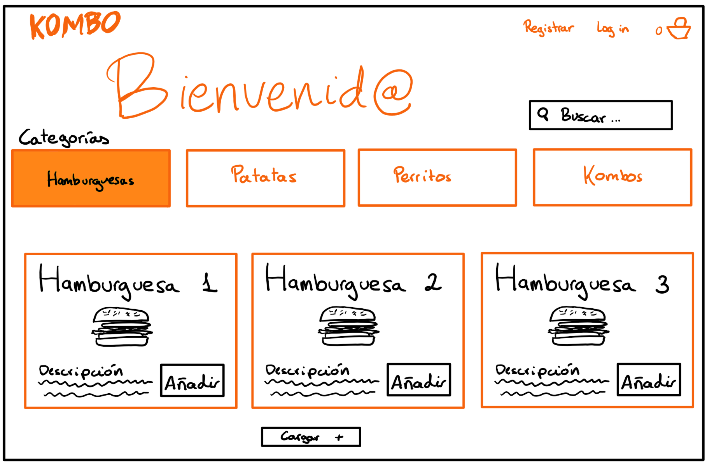
> Home page accessible to anonymous users, registered customers and employees. From here users can access the login page, the profile page, the product detail page and the cart page.

2. **Product detail screen**
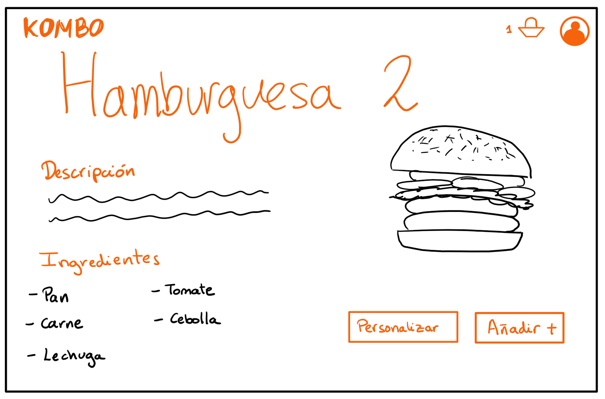

> Product detail page that will be accessible to anonymous users, registered customers and employees. Users can navigate to the home page, the cart page and the user profile page.

3. **Cart screen**
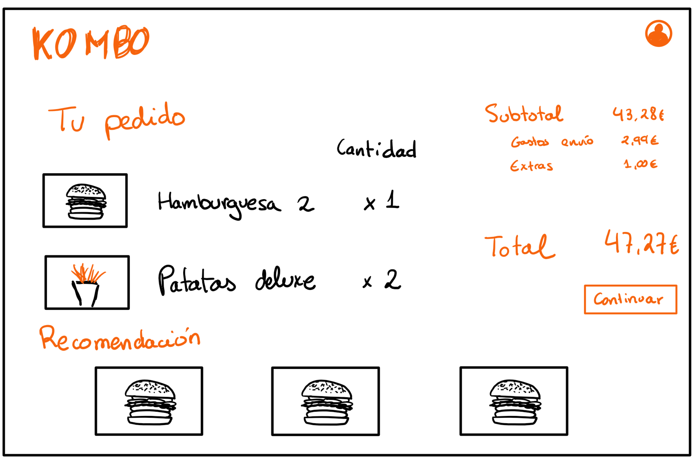
> Page accessible to anonymous users, registered customers and employees. From here users can access the checkout page and the detail page of the recommended products.

4. **Checkout screen**
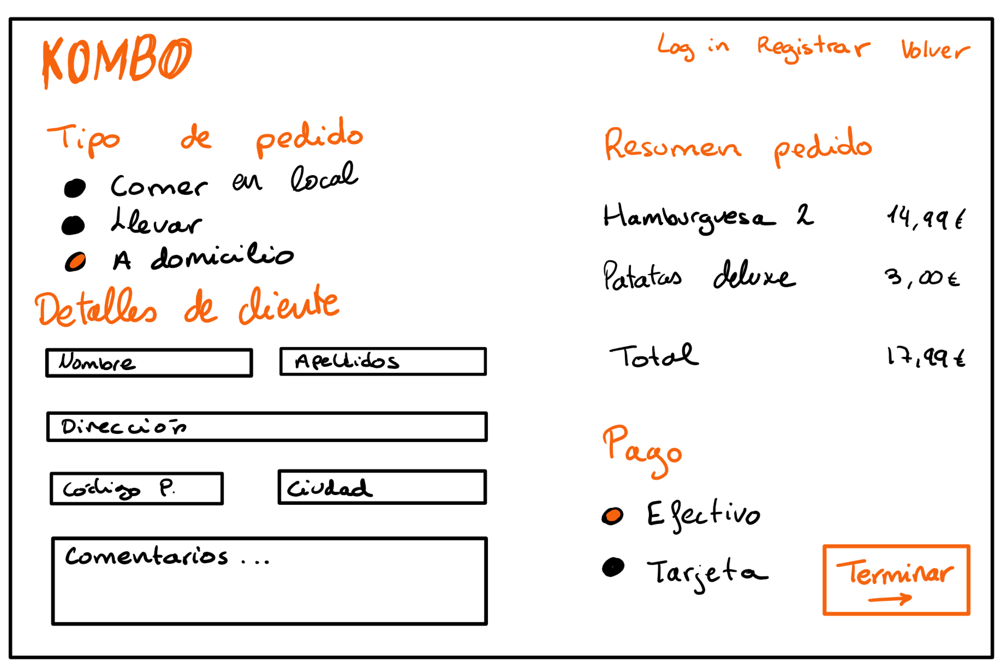
> Checkout page that is accessible to anonymous users, registered users and employees. From here users can navigate to the home page or go back to the cart.

5. **Log-in screen**
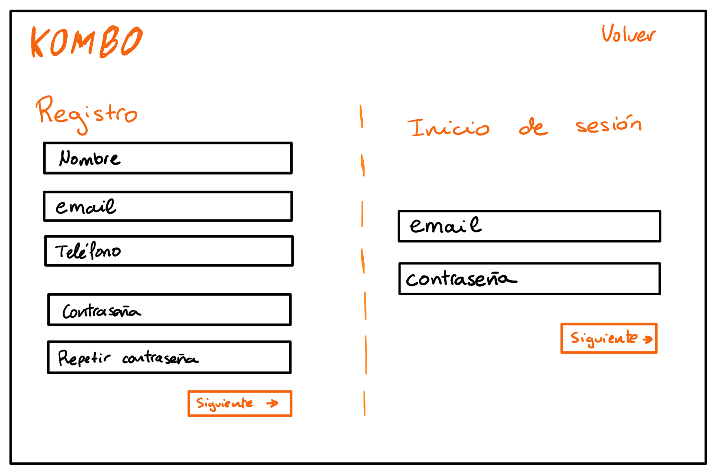
> Log in or sign up page, which will be accessed by anonymous users. From here users can go back to the home page.

6. **Profile screen**
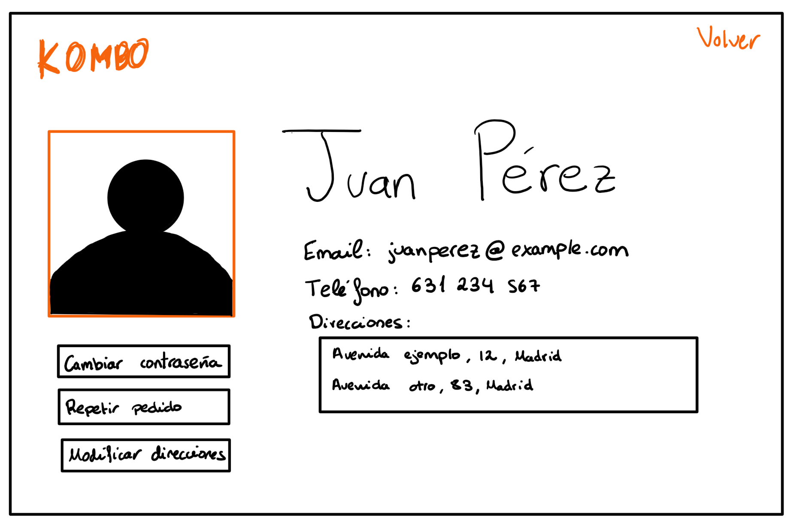
> Profile page that will be accessible to registered customers and employees. Users can navigate to the home page and the cart page.

7. **Order dashboard screen**
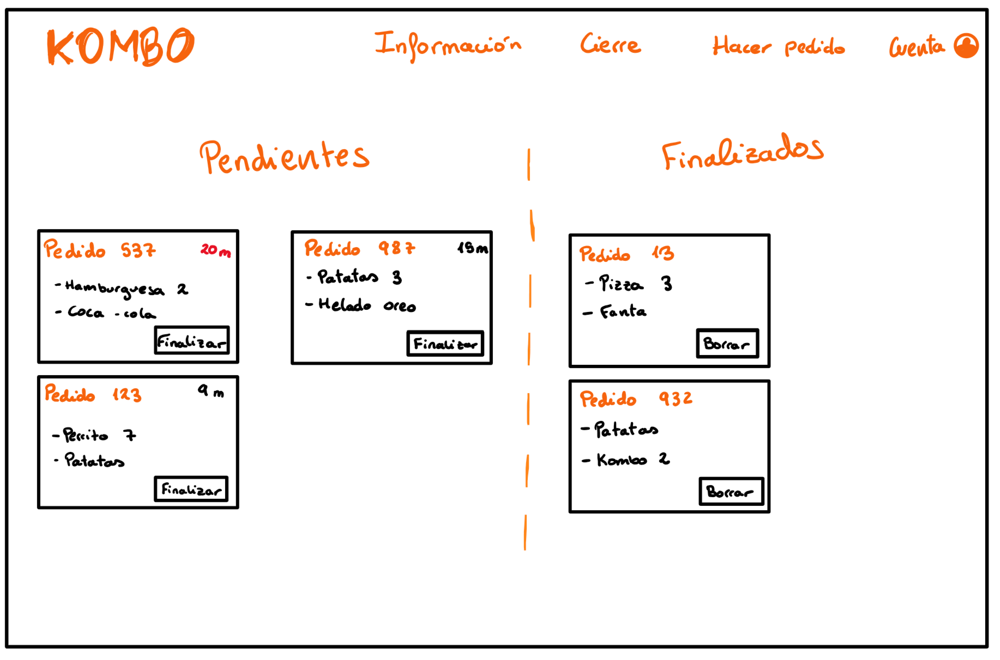
> Order dashboard screen that will be accessible to employees. Employees can navigate to the home page, the inventory page and the cash register closing page.

8. **Inventory screen**
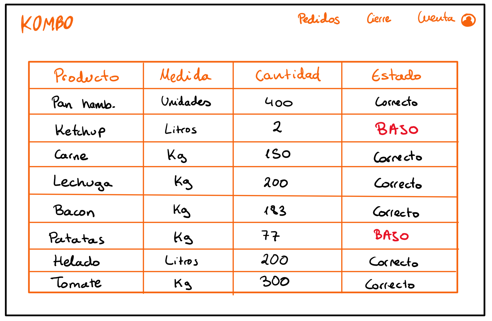
> Inventory screen that will be accessible to employees. Employees can navigate to the home page, the order dashboard page and the cash register closing page.

9. **Cash register closing screen**
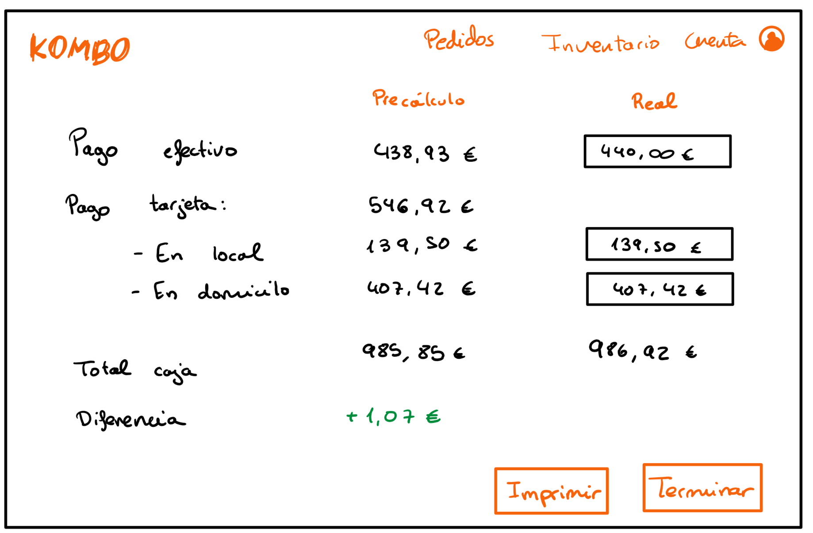
> Cash register closing screen that will be accessible to employees. Employees can navigate to the home page, the inventory page and the order dashboard page.

10. **General dashboard screen**
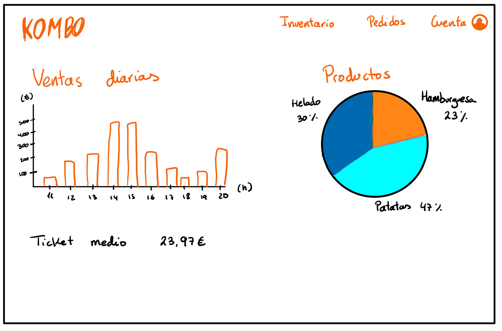
> General dashboard screen that will only be accessible to the administrator. The administrator can navigate to the product management page, the inventory management page and the user management page.

11. **Product management screen**
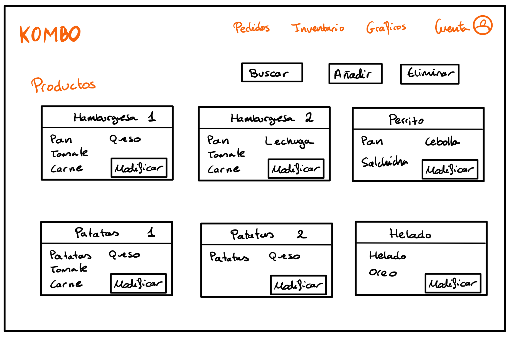
> Product management screen that will only be accessible to the administrator. The administrator can navigate to the general dashboard page, the inventory management page and the user management page.

12. **Inventory management screen**

> Inventory management screen that will only be accessible to the administrator. The administrator can navigate to the product management page, the general dashboard page and the user management page.

13. **User management screen**
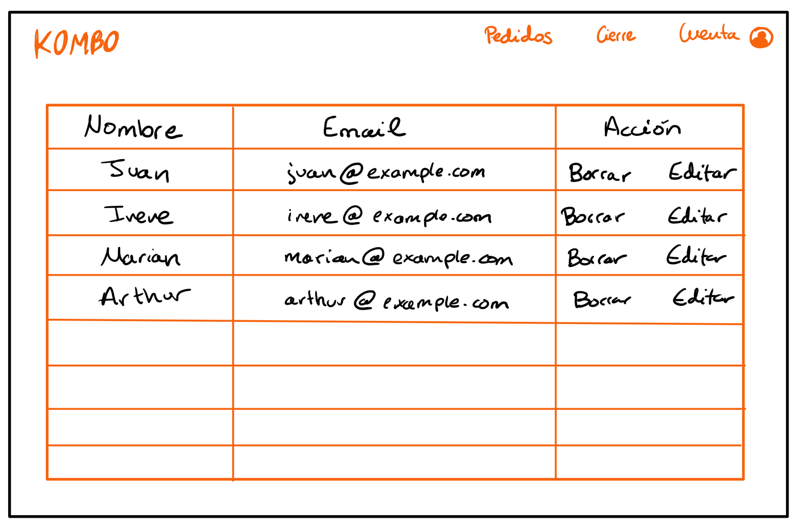
> User management screen that will only be accessible to the administrator. The administrator can navigate to the product management page, the inventory management page and the general dashboard page.

**Navigation flow**
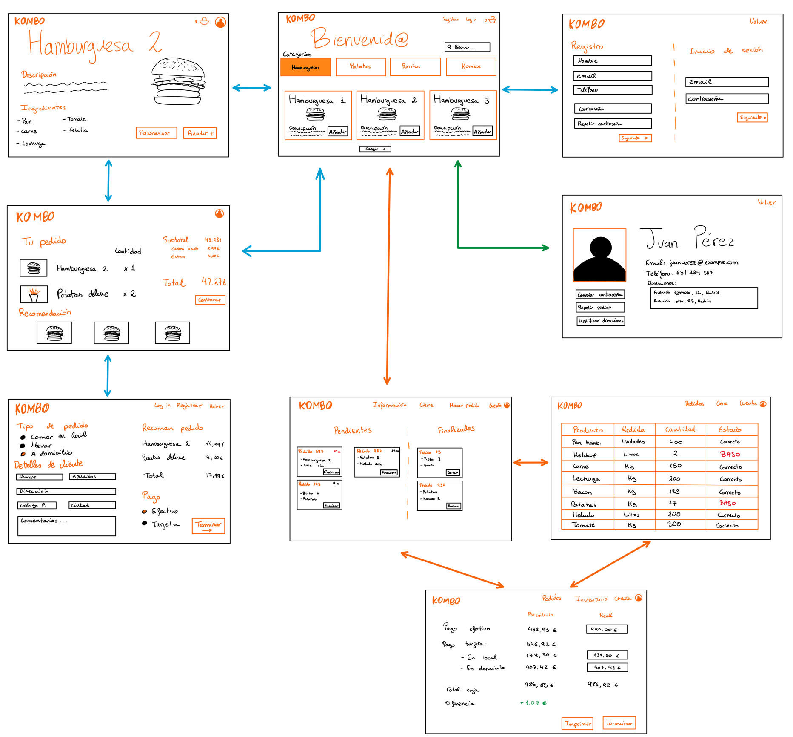
> Navigation diagram of the application, showing the pages each type of user can access. Blue represents the flow of anonymous users, green the flow of registered customers and orange the flow of employees. Registered customers and employees can also follow the flow of anonymous users, and employees can also follow the flow of registered customers.

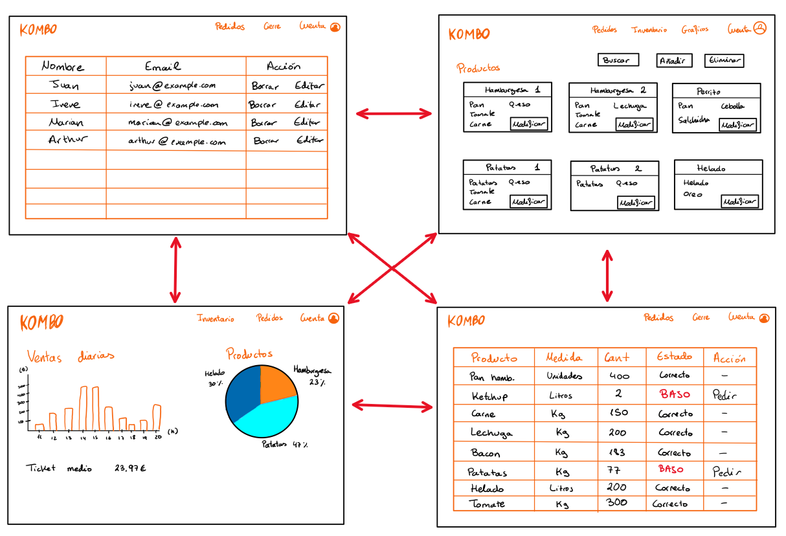
> Navigation diagram of the administrators.

> [!WARNING]
> **Project status: only the functional and technical objectives of the application have been defined, and development has started, but the implementation is not functional yet.**

## Index

- [Objectives](docs/objectives.md)
- [Methodology](docs/methodology.md)
- [Detailed features](docs/features.md)
- [Analysis](docs/analysis.md)
- [Tracking](docs/tracking.md)
- [Author](docs/author.md)
- [Development guide](docs/development-guide.md)
- [Use of AI tools](#-use-of-ai-tools)
- [Changelog](CHANGELOG.md)

## 🤖 **Use of AI tools**

Summary of the AI tools used in each phase of the project:

| Phase | Status | Tool | Use |
| :---- | :----- | :--- | :-- |
| Phase 1: Definition of features and screens | Completed | Claude Sonnet 5.5 (Anthropic) | Conversion of the documentation to Markdown, writing and structuring of the README, proposal of the mockup descriptions and Gantt chart. The mockups and the design decisions are the author's |
| Phase 2: Repository, tests and CI | In progress | Claude (Anthropic), claude-opus-5-5 | Phase planning, GitHub issues proposal, guidance and initial code for the backend, frontend, automated tests and CI workflows, error diagnosis and documentation drafting |
| Phase 3: Version 0.1 - Basic features and Docker | Pending | | |
| Phase 4: Version 0.2 - Intermediate features and deployment | Pending | | |
| Phase 5: Version 1.0 - Advanced features | Pending | | |
| Phase 6: Report | Pending | | |
| Phase 7: Defence | Pending | | |

> The [AI_USAGE.md](docs/AI_USAGE.md) file contains detailed information about each use: date, phase, objective, tool, version, configuration, how it was used, add-ons and context files.
