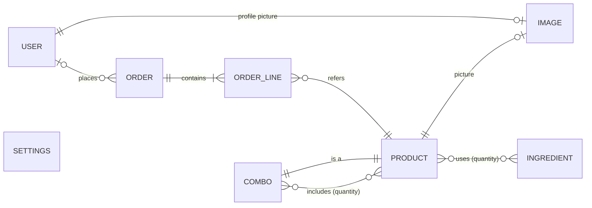

# Analysis

[← Back to README](../README.md)

The screen mockups and the navigation flow are in the [README](../README.md).

## Entities
1. **Entity 1**: User.
2. **Entity 2**: Image.
3. **Entity 3**: Ingredient.
4. **Entity 4**: Product.
5. **Entity 5**: Combo.
6. **Entity 6**: Order.
7. **Entity 7**: OrderLine.
8. **Entity 8**: Settings.

Compared to the first version of the analysis, two entities have been added. **Combo** is a special type of product that groups several products, and **OrderLine** replaces the direct relation between Order and Product, so that each line of an order stores its quantity and the price paid. **Settings** was added later to store the delivery cost, which the administrator can change.

- User - Order (1:N): a user can place several orders, but an order belongs to one user (anonymous orders do not have a user).

- Order - OrderLine (1:N): an order is made up of N lines, and each line belongs to one order. The lines are created and deleted with their order.

- OrderLine - Product (N:1): each line refers to one product (or combo), and a product can appear in N lines of different orders.

- Product - Ingredient (N:N): a product contains N ingredients, each one with the quantity used, and an ingredient can be in N products.

- Combo - Product (inheritance): a combo is a product, so it can be shown in the menu, added to the cart and ordered like any other product.

- Combo - Product (N:N): a combo contains N products, each one with its quantity, and a product can be in N combos.

- Image - User (1:1): each user has an associated image and an image belongs to one user.

- Settings has no relations: it is a single row with the values of the restaurant that the administrator can change (the delivery cost).

- Image - Product (1:1): each product has an associated image and an image belongs to one product.

The following diagram shows the entities and their relations. A combo is a product, so it also has the relations of Product (image, ingredients and order lines).

**Legend.** Each end of a line shows how many entities of that side take part in the relation: the outer symbol is the maximum and the inner symbol (next to the line) is the minimum.

| Symbol at the end of the line | Meaning | Example |
| :---: | :--- | :--- |
| `‖` (two bars) | Exactly one | An order line belongs to exactly one order |
| `o\|` (circle and bar) | Zero or one | An order has zero or one user (anonymous orders have none) |
| `\|<` (bar and crow's foot) | One or more | An order has one or more lines |
| `o<` (circle and crow's foot) | Zero or more | A user places zero or more orders |

The text on each line names the relation, and *(quantity)* means that the relation also stores a quantity (for example, the grams of an ingredient used by a product). `SETTINGS` has no lines because it is not related to other entities.

### Entity attributes
**User**
- Id: identifier.
- Name.
- Surname.
- Email: unique, used to log in.
- Phone number.
- Password.
- Role: customer, employee or administrator.
- Addresses: list of saved addresses.
- Image.

The last order of a user is not stored as an attribute: it is obtained from the orders of the user, sorted by date.

**Image**
- Id: identifier.
- Image: binary content, stored in the database.
- Content type: format of the image (for example JPEG or PNG).
- Text: alternative text.

**Ingredient**
- Id: identifier.
- Name.
- Unit of measurement.
- Current stock.
- Alert limit: when the stock is equal to or lower than this value, the ingredient is shown as low stock.

**Product**
- Id: identifier.
- Name.
- Image.
- Price.
- Description.
- Category.
- Active: boolean that indicates whether it is shown to users.
- Ingredients: ingredients used and the quantity of each one.

**Combo** (all the attributes of Product, plus)
- Products: products included in the combo and the quantity of each one.

The ingredients used by a combo are the sum of the ingredients of its products, multiplied by their quantities.

**Order**
- Id: identifier.
- Order number: unique, 1000 + id.
- User: empty for anonymous orders and for the counter orders of employees.
- Lines: products of the order (OrderLine).
- Delivery type: eat in, take away or delivery.
- Delivery address.
- Status: in preparation, ready, delivered or cancelled.
- Payment method: card or cash.
- Paid: boolean that indicates whether the order has been paid.
- Customer name, email and phone: data of the checkout form.
- Creation date.
- Delivery date.
- Delivery cost: only for home deliveries with a subtotal below 25 €, taken from Settings.
- Total price: sum of the lines plus the delivery cost.

**OrderLine**
- Id: identifier.
- Product.
- Product name: name of the product at the time of the purchase.
- Quantity.
- Unit price: price of the product at the time of the purchase, so that past orders do not change if the price changes.

**Settings**
- Id: identifier.
- Delivery cost: cost of home deliveries (2,50 € by default), changed by the administrator.

## User permissions

| Action | Anonymous | Customer | Employee | Administrator |
| :----- | :-----: | :-----: | :------: | :-----------: |
| View the menu, the product detail and the recommendations | X | X | X | X |
| Sign up | X | | | |
| Log in | | X | X | X |
| Create an order and pay it (simulated payment); employees create counter orders | X | X | X | |
| Check out without filling in the data form | | X | | |
| Download the PDF ticket of their own order | X | X | | |
| View their order history and repeat the last one | | X | | |
| Manage their profile (personal data, password and picture) | | X | X | X |
| Delete their account | | X | X | |
| Manage their saved addresses | | X | | |
| View all the orders | | | X | X |
| Change the status of an order and mark a cash payment as paid | | | X | X |
| Download the PDF ticket of any order | | | X | X |
| View the ingredient inventory | | | X | X |
| View the cash register closing | | | X | X |
| Manage products and kombos (create, edit, deactivate and activate again, picture) | | | | X |
| Change the delivery cost | | | | X |
| Manage ingredients and restock | | | | X |
| Manage employees and customers: create, see, change and delete their accounts | | | | X |
| View the dashboard and the sales reports | | | | X |

## Entities with associated images
- **User**: profile picture. A default one will be set when the user is created, and the user will be able to change it in the settings.

- **Product**: picture of the product.

## Complementary technology
- **PDF order ticket generation**: the ticket of each order will be generated in a PDF. It will contain the name of the restaurant, the order number, the products of the order and the price paid.

- **Email sending** to users when they sign up on the website.

## Advanced query algorithm
- **Cart recommendations**: users will be recommended products they can buy based on the products most often bought together with the ones already in the cart.

## Charts
- **Daily sales chart**: a bar chart showing the number of orders sold per hour.
- **Best-selling products chart**: a pie chart showing the best-selling products of the month.
