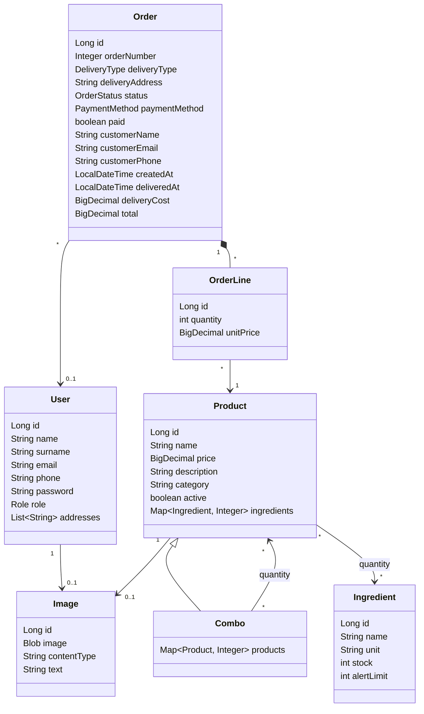
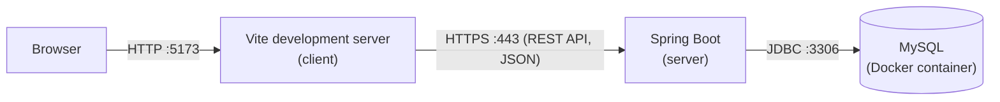
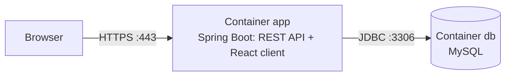
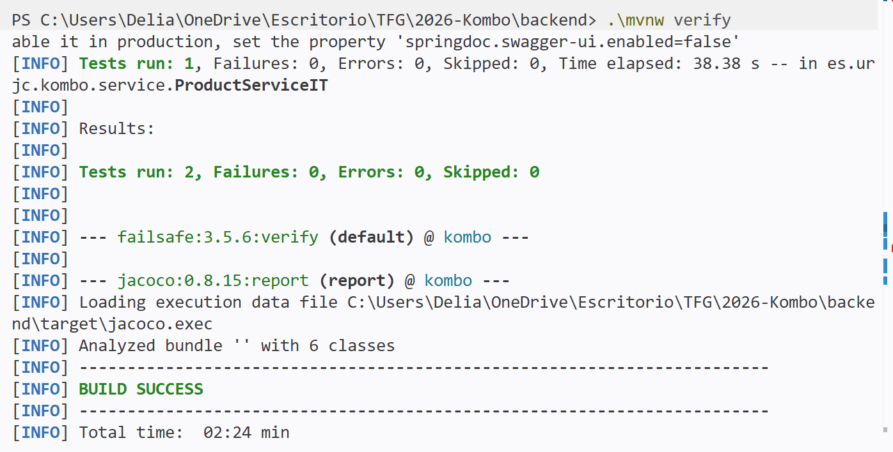
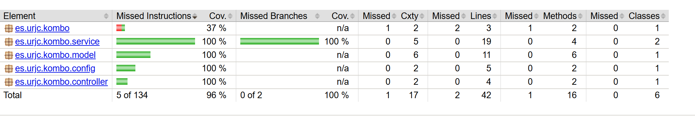
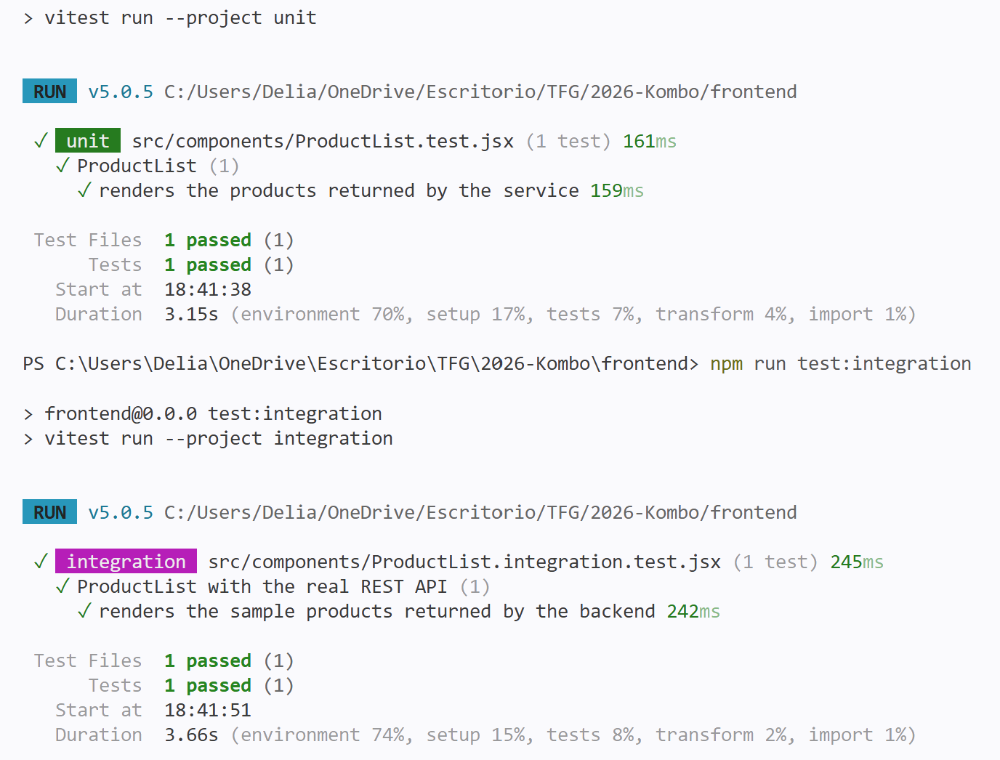
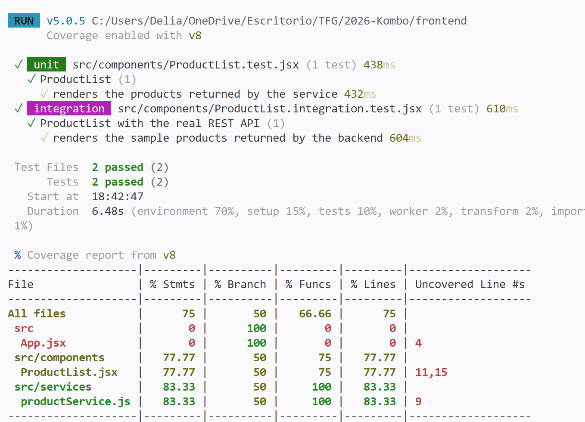
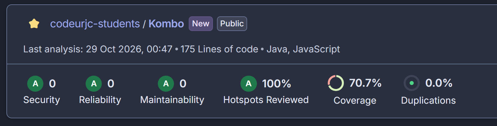
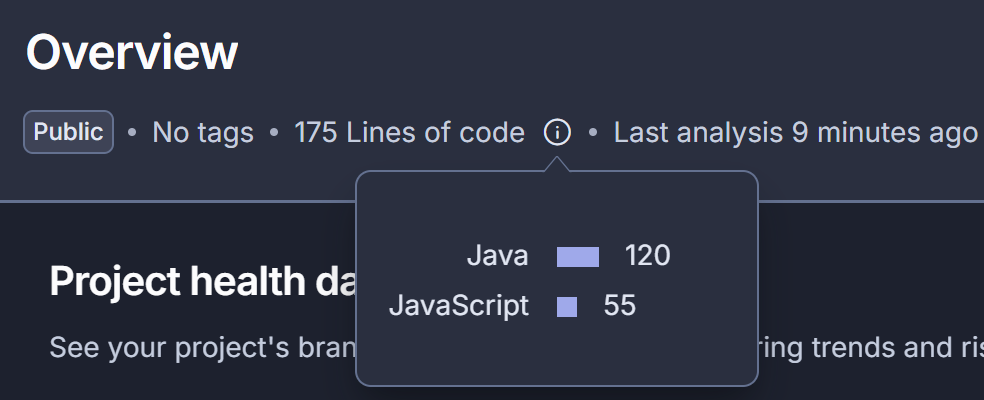

# Development guide

[← Back to README](../README.md)

- [Introduction](#introduction)
- [Technologies](#technologies)
- [Tools](#tools)
- [Architecture](#architecture)
  - [Domain model](#domain-model)
  - [Deployment](#deployment)
  - [Security](#security)
  - [Client](#client)
  - [REST API](#rest-api)
- [Quality control](#quality-control)
  - [Automated tests](#automated-tests)
  - [Static code analysis](#static-code-analysis)
- [Development process](#development-process)
  - [Task management](#task-management)
  - [Git](#git)
  - [Continuous integration](#continuous-integration)
  - [Continuous delivery](#continuous-delivery)
  - [Publishing a release](#publishing-a-release)
- [Running and editing the code](#running-and-editing-the-code)
  - [Cloning the repository](#cloning-the-repository)
  - [Configuration (environment variables)](#configuration-environment-variables)
  - [HTTPS certificate](#https-certificate)
  - [Running the application](#running-the-application)
  - [Running with Docker](#running-with-docker)
  - [Using the tools](#using-the-tools)
  - [Running the tests](#running-the-tests)

## Introduction

Kombo is a web application with a SPA (Single Page Application) architecture. In a SPA, the browser loads a single HTML page once and, from then on, the JavaScript code changes the content of the page and requests the data from the server through a REST API, without reloading the page. The application has three parts: the client (a SPA developed with React that runs in the browser), the server (a REST API developed with Spring Boot that contains the business logic and returns the data in JSON format) and the database (MySQL).

| | |
| :--- | :--- |
| **Type** | Web SPA with REST API |
| **Technologies** | Java, Spring Boot, MySQL, JavaScript, React |
| **Tools** | Visual Studio Code, Maven, Node.js and npm, Vite, Git, GitHub, Docker, Postman |
| **Quality control** | Unit, integration and system tests of server and client (JUnit, Mockito, Testcontainers, Rest Assured, Selenium, Vitest and Testing Library), test coverage (JaCoCo and Vitest), static code analysis (SonarQube Cloud) and continuous integration (GitHub Actions) |
| **Deployment** | Docker image (client and server in one Spring Boot jar, over HTTPS) published in DockerHub, run with Docker Compose together with MySQL |
| **Development process** | Iterative and incremental, Git with GitHub Flow, task management with GitHub Issues and GitHub Projects, continuous integration with GitHub Actions |

## Technologies

- **Java 21**: programming language of the server. https://www.java.com
- **Spring Boot 4.1**: framework used to develop the server. It provides the REST API (Spring Web MVC) and the access to the database (Spring Data JPA, with Hibernate). https://spring.io/projects/spring-boot
- **Spring Security 7**: authentication (BCrypt passwords, `UserDetailsService`) and access rules by role and owner. https://spring.io/projects/spring-security
- **JJWT**: creates and validates the JSON Web Token (JWT) of the session. https://github.com/jwtk/jjwt
- **springdoc-openapi**: generates the OpenAPI documentation of the REST API from the controllers and offers it with Swagger UI. https://springdoc.org
- **MySQL 8.4**: relational database where the server stores the data. https://www.mysql.com
- **React 19**: JavaScript library used to develop the client. https://react.dev
- **React Router 8**: navigation between the pages of the client (SPA) and protected routes. https://reactrouter.com
- **React Bootstrap 2 and Bootstrap 5.3**: responsive components of the client (navigation bar, forms, tables, alerts). https://react-bootstrap.netlify.app

## Tools

- **Visual Studio Code**: code editor, with the *Extension Pack for Java* and *Spring Boot Extension Pack* extensions. https://code.visualstudio.com
- **Maven**: dependency management and build of the server. It is used through the Maven Wrapper (`mvnw`) included in the repository. https://maven.apache.org
- **Node.js and npm**: runtime and package manager of the client. https://nodejs.org
- **Vite**: creates, runs and builds the client. In development, it forwards the requests to `/api` to the server. https://vite.dev
- **Git and GitHub**: version control and code repository. https://github.com
- **Docker and Docker Compose**: build the image of the application and run it with its database; also run the database during development and the databases of the integration tests. https://www.docker.com
- **Postman**: used to make requests to the REST API. https://www.postman.com
- **keytool**: tool of the JDK that generates the self-signed certificate (keystore) used for HTTPS. https://docs.oracle.com/en/java/javase/21/docs/specs/man/keytool.html
- **Redocly CLI**: generates the HTML documentation of the REST API from the OpenAPI specification. https://redocly.com/docs/cli
- **ESLint**: checks the JavaScript code of the client. https://eslint.org
- **SonarQube Cloud**: static code analysis service that detects bugs, vulnerabilities, code smells and duplicated code, and shows the test coverage. https://sonarcloud.io

## Architecture

### Domain model

The persistent entities of the server are in the package `es.urjc.kombo.model`. The [analysis](analysis.md) describes each attribute.



- **Combo extends Product** (single table inheritance), so a combo can be used wherever a product is expected. `getIngredientUsage()` returns the quantity of each ingredient used when one unit is sold; a combo overrides it to add up the ingredients of its products.
- **OrderLine** stores the unit price at the time of the purchase, so past orders and the cash register closing do not change if a price changes.
- The enumerations are declared inside the entity that uses them (`User.Role`, `Order.DeliveryType`, `Order.OrderStatus` and `Order.PaymentMethod`) and are stored as text.
- Images are stored in the database. They are loaded lazily, only when they are needed.

### Deployment

During development, each part of the application runs as an independent process:



- The browser loads the client from the Vite development server (port 5173).
- The client calls the REST API with requests to `/api`, which Vite forwards to the server over HTTPS (port 443). The data is exchanged in JSON format.
- The server only accepts HTTPS, with a self-signed certificate (see [HTTPS certificate](#https-certificate)).
- The server accesses the MySQL database (port 3306) with JDBC. The database runs in a Docker container.


With Docker, the client and the server are packaged in a single image (see [Running with Docker](#running-with-docker)):



- The image is built in three stages (`docker/Dockerfile`): the React client is built with Node.js, its static files are copied into the Spring Boot jar, and the final image only contains the Java runtime (JRE) and the jar.
- The server returns the client for `/` and for the client routes (`SpaConfig` returns `index.html` for any path that is not a file or `/api`), so the client and the REST API share the same origin and the session cookie works without CORS.
- Inside the container the server listens on port 8443 (a non-root user cannot use ports below 1024) and Docker Compose publishes it as port 443.

### Security

Users log in with their email and password. Passwords are stored encoded with BCrypt. Authentication is stateless: there is no HTTP session in the server.

1. The client sends `POST /api/v1/auth/login` with `{ "email", "password" }`.
2. The server checks them (`KomboUserDetailsService` loads the user, Spring Security compares the BCrypt hash) and answers with the user data and a JSON Web Token (JWT) signed with `KOMBO_JWT_SECRET`, in a cookie called `kombo_token`. The cookie is `HttpOnly` (JavaScript cannot read it, which protects it from XSS), `Secure` (only sent over HTTPS) and `SameSite=Strict` (not sent in requests started from other sites, which protects from CSRF). It expires after `KOMBO_JWT_EXPIRATION` (2 hours by default).
3. The browser sends the cookie in every request. `JwtAuthenticationFilter` validates the token and loads the user, with its role.
4. `POST /api/v1/auth/logout` deletes the cookie.

**Roles.** Every user has one role: `CUSTOMER`, `EMPLOYEE` or `ADMIN`. Customers and employees are stored in the database (the sample data creates `customer@kombo.com` and `employee@kombo.com`). There is only one administrator: `AdminInitializer` creates it when the application starts, with the email `KOMBO_ADMIN_EMAIL` and the BCrypt hash of the password `KOMBO_ADMIN_PASSWORD_HASH` (the plain password is never in the code or the configuration). Changing the variable and restarting changes the password.

**Endpoints and access rules** (`SecurityConfig`, and `@PreAuthorize` and `OrderService` for the ownership rules):

| Endpoint | Anonymous | Customer | Employee | Administrator |
| :--- | :---: | :---: | :---: | :---: |
| `POST /api/v1/auth/login`, `POST /api/v1/auth/logout` | ✓ | ✓ | ✓ | ✓ |
| `GET /api/v1/auth/me` (logged in user) | 401 | ✓ | ✓ | ✓ |
| `GET /api/v1/products/**` (menu) | ✓ | ✓ | ✓ | ✓ |
| `GET /api/v1/users` | 401 | 403 | 403 | ✓ |
| `GET /api/v1/users/{id}` and `GET /api/v1/users/{id}/orders` | 401 | Only their own (403) | Only their own (403) | ✓ |
| `GET /api/v1/orders/{id}` | 401 | Only their own (403) | ✓ | ✓ |
| Any other `/api/**` endpoint | 401 | ✓ | ✓ | ✓ |

Errors 401 (not logged in, invalid or expired token, wrong credentials) and 403 (role not allowed or data of another user) have the same `ProblemDetail` format as the rest of the errors of the REST API.

### Client

The client is a React SPA. Its code is in `frontend/src`:

| Folder or file | Content |
| :--- | :--- |
| `main.jsx`, `App.jsx`, `routes.jsx` | Entry point, router (`createBrowserRouter`) and the routes of the application |
| `theme.css` | Design tokens: the palette, the typefaces and the Bootstrap variables, defined in a single place |
| `context/` | `AuthContext` and `AuthProvider`: session state (`user`, `loading`, `login`, `logout`) shared by every page |
| `services/` | `httpClient.js` (common HTTP client: `credentials: 'include'`, JSON and `ApiError` with the status and the `detail` of the ProblemDetail) and one service per resource: `authService`, `productService` and `userService` |
| `hooks/` | `usePagedList`: loads the pages of a paginated resource, with loading, error, retry and the *Más resultados* button |
| `components/` | `Layout` (navigation bar, content, footer and confirmation messages), `AppNavbar`, `ProtectedRoute`, `ProductList`, `ProductCard`, `StatusPage`, `LoadingState` and `ErrorState` |
| `pages/` | One component per page: `HomePage`, `LoginPage`, `ProfilePage`, `UsersPage`, `NotFoundPage` and `ErrorPage` |

**Lists.** Lists with more than 10 items (menu, order history and users) show the first 10 and a *Más resultados* button that loads the next 10.

**Session.** The JWT is in an httpOnly cookie that JavaScript cannot read, so when the application starts `AuthProvider` asks `GET /api/v1/auth/me` who the user is. `ProtectedRoute` only shows its pages to logged in users with an allowed role: anonymous users are sent to the log in page (and back to the page they wanted after logging in) and other roles see a 403 page. The server checks the same rules; the client only avoids showing pages that would fail.

**Pages and navigation by role:**

| Route | Page | Anonymous | Customer | Employee | Administrator |
| :--- | :--- | :---: | :---: | :---: | :---: |
| `/` | Menu with category filter | ✓ | ✓ | ✓ | ✓ |
| `/login` | Log in | ✓ | | | |
| `/profile` | Profile (and order history of the customer) | | ✓ | ✓ | ✓ |
| `/admin/users` | Users | | | | ✓ |
| Any other | 404 page | ✓ | ✓ | ✓ | ✓ |

The navigation bar only shows the links of the role of the user, plus the name, the role and a *Cerrar sesión* (log out) button, always visible.

**Design.** The look comes from the Kombo logo: its oranges (`#f39a2b`, `#ea5d2f` and `#e5412a`) are the main colours, combined with a cool navy ink for text, a teal accent for roles and a warm off-white background. They are defined once in `theme.css`, together with the logo gradient. The logo (with transparent background) and the favicon are in `frontend/public` (`logo-horizontal.png`, `logo-icon.png`, `logo-vertical.png`, `favicon.ico`, `favicon.png` and `apple-touch-icon.png`). The headings use *Montserrat*, close to the letters of the logo, and the body text *DM Sans* (installed with npm, so they work without Internet). Buttons and orange text use a darker orange (`#cf4517`), because white text on the bright orange of the logo does not reach the WCAG AA contrast. The home page opens with an orange banner with the logo; each product card shows the picture (or the Kombo icon if it has none), its category, the name, a short description and the price in orange. Every page gives feedback: loading states (spinners and skeletons), errors with a *Retry* button, hover and keyboard focus states, and confirmation messages (for example, after logging in or out). The layout is responsive: the product grid adapts its columns, the navigation bar collapses into a menu on mobile and tables scroll horizontally. The 404, 403 and error pages use the same layout and style.

### REST API

The documentation of the REST API, generated with OpenAPI, can be seen here: [REST API documentation](https://raw.githack.com/codeurjc-students/2026-Kombo/main/docs/api/api-docs.html).

## Quality control

### Automated tests

The server and the client have unit, integration and system tests. The system tests of the REST API use HTTPS, with a temporary self-signed certificate and Rest Assured configured with `relaxedHTTPSValidation`. In this phase, the only feature implemented is a minimal version of *View the menu by category on the home page* (basic features, anonymous user): the home page shows the list of sample products. All the tests check this feature:

| Type | Part | Tool | Test | What it checks |
| :--- | :--- | :--- | :--- | :------------- |
| Unit | Server | JUnit and Mockito | `ProductServiceTest` | The service returns the pages of products, filters by category (a blank category is the whole menu), returns the product image and fails when a product or its image does not exist, with the database mocked |
| Integration | Server | JUnit and Testcontainers | `ProductServiceIT` | The service returns the active products, the combos in their category, the pages, the detail of products and combos and the images stored in a real MySQL database (without sample data) |
| Integration | Server | JUnit and Testcontainers | `SampleDataLoaderIT` | The sample data (products, combos, ingredients, users of each role with encoded passwords and orders) is loaded once |
| Integration | Server | JUnit and Testcontainers | `SampleDataDisabledIT` | With `kombo.sample-data.enabled=false` no sample data is loaded, and the only user is the administrator created from the configuration |
| System | Server | JUnit and Rest Assured | `ProductApiIT` | The REST API returns the pages of sample products, the category filter, a page of a category, the product detail, the product image and the 400 and 404 errors |
| Unit | Server | JUnit | `JwtServiceTest` | The JWT is created and validated, tokens with another key, expired or malformed are rejected, and the cookie is `HttpOnly`, `Secure` and `SameSite=Strict` |
| Unit | Server | JUnit and Mockito | `OrderServiceTest` | A customer can only read their own orders; employees and the administrator can read any order |
| Unit | Server | JUnit and Mockito | `AdminInitializerTest` | The administrator is created or updated with the BCrypt hash of the configuration, and a plain password is rejected |
| System | Server | JUnit and Rest Assured (HTTPS) | `AuthApiIT` | Log in (cookie `HttpOnly`, `Secure` and `SameSite=Strict`), wrong credentials (401), `me` with and without session, invalid token (401) and log out |
| System | Server | JUnit and Rest Assured (HTTPS) | `SpaForwardingIT` | The server returns the client (`index.html`) for `/` and for the client routes, and keeps the 404 of unknown REST API endpoints and missing files |
| System | Server | JUnit and Rest Assured (HTTPS) | `AccessRulesApiIT` | 401 without login, 403 with a role that is not allowed, 403 when reading the profile, order history or orders of another user, and access of the owner, employees and administrator |
| Unit | Client | Vitest and Testing Library | `ProductList.test.jsx` | The menu shows the products and their prices, filters by category and goes back to the whole menu with *Todo*, loads more pages, shows errors with *Retry*, the empty state and the image fallback, with the service mocked and a virtual DOM |
| Unit | Client | Vitest | `httpClient.test.js`, `authService.test.js`, `productService.test.js`, `userService.test.js` | The HTTP client sends the cookie (`credentials: 'include'`) and JSON and turns errors into `ApiError`; each service calls its endpoints |
| Unit | Client | Vitest and Testing Library | `AuthProvider.test.jsx` | The session is read on startup, and log in and log out update it |
| Unit | Client | Vitest and Testing Library | `AppNavbar.test.jsx`, `ProtectedRoute.test.jsx` | The navigation bar shows the links of each role and logs out; protected routes redirect anonymous users to the log in page and show 403 to other roles |
| Unit | Client | Vitest and Testing Library | `LoginPage.test.jsx`, `ProfilePage.test.jsx`, `UsersPage.test.jsx`, `StatusPages.test.jsx` | Log in with redirection by role and error messages, profile and order history, users list with pages, and the 404 and error pages |
| Integration | Client | Vitest and Testing Library | `ProductList.integration.test.jsx` | The component shows the list of products obtained from the real REST API, filters the *Menús* category and loads the next products with *Más resultados* |
| Integration | Client | Vitest | `authService.integration.test.js` | Log in with a sample user and 401 with a wrong password, against the real REST API |
| System | Client | JUnit and Selenium | `ProductListE2E` | The sample products are shown on the home page of a real browser, 10 at first and the rest after *Más resultados*, and the *Menús* category shows only the 3 combos |
| System | Client | JUnit and Selenium | `LoginE2E` | A customer logs in, sees their orders and logs out; a wrong password shows an error; anonymous users are sent to the log in page |

The Selenium tests share their setup in `E2ETestSupport`: headless Chrome with a fixed window size, clicks without scroll animation, and a screenshot and the HTML of the page of every failed test in `backend/target/e2e-failures` (in CI, the `e2e-failures` artifact of the run).

Statistics (9 November 2026; the screenshots below are from Phase 2):

| | Server | Client | Total |
| :--- | :---: | :---: | :---: |
| Number of tests | 72 (21 unit, 46 integration and REST API system, 5 Selenium) | 52 (49 unit, 3 integration) | 124 |
| Line coverage | 83.9 % (JaCoCo, `./mvnw verify`) | 95.1 % (unit tests, `npm run test:coverage`) | |









### Static code analysis

The code is analysed with [SonarQube Cloud](https://sonarcloud.io/project/overview?id=codeurjc-students_2026-Kombo) on every push, in the basic quality control workflow. The analysis includes the coverage of all the server tests and of the client unit tests (the client integration and system tests need the server running, so they are not included). The configuration is in `sonar-project.properties`.

| Security | Reliability | Maintainability | Security hotspots reviewed | Coverage | Duplications |
| :---: | :---: | :---: | :---: | :---: | :---: |
| A (0 issues) | A (0 issues) | A (0 issues) | 100 % | 70.7 % | 0.0 % |



Code size (lines of code, without blank lines and comments, measured by SonarQube Cloud):

<!-- TODO: update with the values of SonarQube Cloud -->
| Language | Lines of code |
| :--- | :---: |
| Java | 120 |
| JavaScript | 55 |
| **Total** | **175** |



## Development process

The development follows an iterative and incremental process, which follows the principles of the Agile Manifesto and is supported by some of the good practices of Extreme Programming (XP) and Kanban.

### Task management

The tasks are managed with GitHub Issues and a GitHub Projects board with a Kanban view (*Todo*, *In Progress* and *Done*). Each phase has a milestone, and each issue is closed with the pull request that completes it.

### Git

The code is stored in a Git repository on GitHub. The branching strategy is GitHub Flow:

- `main`: stable branch. No direct commits are made on it: the changes are merged through pull requests, and only if the full quality control passes.
- Feature branches: each task is developed in a branch with a short descriptive name in English (for example, `add-backend-tests`), which is merged into `main` with a pull request.

| Metric | Value (25 October 2026) |
| :--- | :---: |
| Commits in `main` | 22 |
| Branches | 9 |
| Pull requests merged | 7 |

### Continuous integration

The continuous integration is done with two GitHub Actions workflows:

- **Basic quality control** (`.github/workflows/ci-basics.yml`): runs on every commit to a feature branch (and also on `main`, so that SonarQube Cloud analyses the main branch). It builds the server and runs its unit tests, builds the client, checks it with ESLint and runs its unit tests, and analyses the code with SonarQube Cloud.
- **Full quality control** (`.github/workflows/ci-full.yml`): runs when a pull request to `main` is opened or updated. It runs the unit, integration and system tests of the server and the client. The client integration tests and the Selenium tests run against the application started with `docker compose` (`docker/docker-compose-dev.yml --build`, the same image that is published, built from the code of the pull request) at https://localhost, with a `.env` file of test-only values. The `main` branch is protected so that the pull request cannot be merged if this workflow fails.

### Continuous delivery

The Docker image is published in DockerHub (`deliaml10/kombo`) by the **Continuous delivery** workflow (`.github/workflows/cd.yml`). The workflow only decides the tags; the build and the push are done by the reusable workflow `.github/workflows/docker-publish.yml` (`workflow_call`), so the logic is not duplicated:

| Trigger | Image tags | Other |
| :--- | :--- | :--- |
| Push to `main` (merged pull request) | `dev` | `docker/docker-compose.yml` published as an OCI artifact in `deliaml10/kombo-compose:dev`, pointing to the image `dev` |
| Published GitHub release (for example `0.1.0` or `v0.1.0`) | `0.1.0` and `latest` | Compose OCI artifact `deliaml10/kombo-compose:0.1.0` and `deliaml10/kombo-compose:latest`, both pointing to the image `0.1.0` |
| Manual run (*Actions → Continuous delivery → Run workflow*, choosing a branch) | `<branch>-<yyyymmddhhmm>-<commit>` (UTC), for example `add-login-page-202611091352-3f2a9c1` (`/` in the branch name becomes `-`) | |

The workflow needs two repository secrets, created in GitHub in *Settings → Secrets and variables → Actions → New repository secret* (repository administrator permissions are needed):

| Secret | Value |
| :--- | :--- |
| `DOCKERHUB_USERNAME` | DockerHub user (`deliaml10`) |
| `DOCKERHUB_TOKEN` | DockerHub access token with *Read & Write* permission, created in DockerHub in *Account settings → Personal access tokens* (never the password) |

The published Compose application can be run without cloning the repository, with a `.env` file in the current folder:

```
docker compose -f oci://docker.io/deliaml10/kombo-compose:0.1.0 up -d
```

### Publishing a release

1. Merge into `main` all the pull requests of the version, with the full quality control in green.
2. In `CHANGELOG.md`, move the changes of `[Unreleased]` to a section with the version and date (in a pull request).
3. In GitHub, *Releases → Draft a new release*: create the tag (for example `0.1.0`) on `main`, use the version as title and the changelog section as description, and press *Publish release*.
4. The Continuous delivery workflow publishes the images `deliaml10/kombo:0.1.0` and `deliaml10/kombo:latest` and the Compose artifacts `deliaml10/kombo-compose:0.1.0` and `deliaml10/kombo-compose:latest`. Check it in *Actions* and in DockerHub.
5. Try it: `docker compose -f oci://docker.io/deliaml10/kombo-compose:0.1.0 up -d` and open https://localhost.

## Running and editing the code

### Cloning the repository

```
git clone https://github.com/codeurjc-students/2026-Kombo.git
cd 2026-Kombo
```

### Configuration (environment variables)

Secrets are never in the code. The application reads them from environment variables or from a `.env` file in the root of the repository, which Git ignores. Create it from the example and change the values:

```
cp .env.example .env
```

| Variable | Required | Description |
| :--- | :---: | :--- |
| `KOMBO_DB_PASSWORD` | Yes | Password of the MySQL `root` user (the database container is created with it) |
| `KOMBO_DB_URL`, `KOMBO_DB_USERNAME` | No | JDBC URL and user of the database (default `jdbc:mysql://localhost:3306/kombo` and `root`) |
| `KOMBO_ADMIN_EMAIL` | No | Email of the administrator (default `admin@kombo.com`) |
| `KOMBO_ADMIN_PASSWORD_HASH` | Yes | BCrypt hash of the password of the administrator. In `.env`, every `$` is written as `$$` (see below) |
| `KOMBO_JWT_SECRET` | Yes | Key used to sign the session JWT, at least 32 characters (for example `openssl rand -base64 48`) |
| `KOMBO_JWT_EXPIRATION` | No | Duration of the session, ISO-8601 format (default `PT2H`, 2 hours) |
| `KOMBO_SSL_KEY_STORE` | No | Location of the keystore (default `file:certs/kombo-keystore.p12`, relative to the folder where the server runs) |
| `KOMBO_SSL_KEY_STORE_PASSWORD` | Yes | Password of the keystore |
| `SERVER_PORT` | No | HTTPS port (default `443`) |
| `KOMBO_SAMPLEDATA_ENABLED` | No | `false` to start without sample data |

To generate the BCrypt hash of the administrator password (with Docker, or with the `htpasswd` tool of Apache):

```
docker run --rm httpd:2.4-alpine htpasswd -nbBC 10 "" "your-password" | tr -d ':\n'
```

Docker Compose reads `$` as the start of a variable, so in the `.env` file every `$` of the hash is written as `$$` (for example `$$2y$$10$$...`). The server undoes this escape, so the same file works for Docker Compose and for `./mvnw spring-boot:run`. The `.env.example` file contains the hash of the password `admin`, only for local development.

### HTTPS certificate

The server only listens on HTTPS (port 443). For local development it uses a self-signed certificate, generated once with `keytool` (included in the JDK), from the `backend` folder, using the password of `KOMBO_SSL_KEY_STORE_PASSWORD`:

```
keytool -genkeypair -alias kombo -keyalg RSA -keysize 2048 -validity 3650 -storetype PKCS12 -keystore certs/kombo-keystore.p12 -storepass <KOMBO_SSL_KEY_STORE_PASSWORD> -dname "CN=localhost" -ext "SAN=dns:localhost,ip:127.0.0.1"
```

The `certs` folder is ignored by Git. As the certificate is not signed by a known authority, the browser shows a warning the first time (*Advanced* → *Continue to localhost*), and Postman needs *SSL certificate verification* disabled. The automated tests generate their own temporary certificate (`keytool-maven-plugin` in `pom.xml`), so they need no configuration.

On Linux and macOS, port 443 needs administrator permissions: use `sudo` or change the port with `SERVER_PORT=8443` (and `KOMBO_BACKEND_URL=https://localhost:8443` for the client).

### Running the application

1. Create the `.env` file and the certificate (see the two sections above).

2. Run the database with Docker (Docker Desktop on Windows and Mac, Docker and Docker Compose on Linux), from the root of the repository:

   ```
   docker compose --env-file .env -f docker/docker-compose-db.yml up -d
   ```

   If the database was created before with another password, recreate it with `down -v` (this deletes its data).

3. Run the server, from the `backend` folder (Java 21 is required):

   ```
   ./mvnw spring-boot:run
   ```

   On Windows PowerShell: `.\mvnw spring-boot:run`. The REST API is at https://localhost/api/v1.

4. Run the client, from the `frontend` folder, in another terminal (Node.js is required):

   ```
   npm install
   npm run dev
   ```

5. Open the web application at http://localhost:5173. Vite forwards `/api` to https://localhost (`KOMBO_BACKEND_URL` changes it).

### Running with Docker

Only Docker is needed (Docker Desktop on Windows and Mac). From the root of the repository:

1. Create the `.env` file from `.env.example` (see [Configuration](#configuration-environment-variables)).
2. Run the application with one of the two Compose files:

   | File | Image | Use |
   | :--- | :--- | :--- |
   | `docker/docker-compose.yml` | `deliaml10/kombo:0.1` | Version 0.1, published in DockerHub |
   | `docker/docker-compose-dev.yml` | `deliaml10/kombo:dev` | Last version of `main`, published by CI, or built from the local code with `--build` |

   ```
   docker compose --env-file .env -f docker/docker-compose.yml up -d
   docker compose --env-file .env -f docker/docker-compose-dev.yml up -d
   docker compose --env-file .env -f docker/docker-compose-dev.yml up -d --build
   ```

   `--env-file .env` is needed because Docker Compose looks for the `.env` file in the folder of the Compose file (`docker/`), and the `.env` file is in the root of the repository.

3. Open https://localhost: the client and the REST API (https://localhost/api/v1, Swagger UI at https://localhost/swagger-ui.html) are served by the same container. The certificate is self-signed, so the browser shows a warning the first time.

Each Compose file runs two services:

- `db`: MySQL 8.4 with its data in a volume. Its *healthcheck* connects with the `mysql` client over TCP, so it only passes when the real server is ready (while MySQL creates the database it runs a temporary server without network), and `app` waits for it (`depends_on: condition: service_healthy`).
- `app`: the Kombo image, configured only with environment variables taken from `.env`: `KOMBO_DB_PASSWORD`, `KOMBO_ADMIN_EMAIL`, `KOMBO_ADMIN_PASSWORD_HASH`, `KOMBO_JWT_SECRET`, `KOMBO_SSL_KEY_STORE_PASSWORD` and `KOMBO_SAMPLEDATA_ENABLED`. Compose stops with a clear message if a required variable is missing.

**HTTPS certificate in Docker.** When the container starts, `docker/entrypoint.sh` generates a self-signed keystore with `keytool` if there is none, and keeps it in the `certs` volume, so no private key is stored in the image or in Git. To use your own certificate, mount a PKCS12 keystore with the alias `kombo` in `/app/certs/kombo-keystore.p12` (or point `KOMBO_SSL_KEY_STORE` to it).

Other useful commands:

```
docker compose -f docker/docker-compose.yml logs -f app   # logs of the application (same -f for the next commands)
docker compose -f docker/docker-compose.yml down      # stops and removes the containers (the data is kept)
docker compose -f docker/docker-compose.yml down -v   # also deletes the data and the certificate
docker build -f docker/Dockerfile -t deliaml10/kombo:dev .   # builds the image without Compose
```

### Sample data

When the server starts with an empty database, it loads sample data (class `SampleDataLoader`, in `es.urjc.kombo.config`):

- 15 ingredients with their stock (*Bacon* starts below its alert limit, to show a low stock ingredient).
- 9 products in the categories *Burgers*, *Sides*, *Drinks* and *Desserts*, each one with its ingredients and quantities, and 3 combos (*Menú clásico*, *Menú de pollo* and *Menú familiar*). The names, descriptions and units of the products and ingredients are in Spanish, because the application shows them to the users; the code and the keys of the products are in English.
- A customer and an employee, with the password encoded with BCrypt (the administrator is not sample data: it is created from the configuration, see [Security](#security)):

  | Role | Email | Password |
  | :--- | :--- | :--- |
  | Customer | `customer@kombo.com` | `customer` |
  | Employee | `employee@kombo.com` | `employee` |
  | Administrator | `KOMBO_ADMIN_EMAIL` (`admin@kombo.com`) | The one of `KOMBO_ADMIN_PASSWORD_HASH` (`admin` with `.env.example`) |

- 4 orders, of the customer and of anonymous users, in every status.
- The pictures of the products, read from `backend/src/main/resources/sample-images/` and stored in the database. The [README of that folder](../backend/src/main/resources/sample-images/README.md) lists the expected files; a product without its file is loaded without picture.

The loading is controlled by the property `kombo.sample-data.enabled` (in `application.properties`), which is `true` by default. If the database already has products, nothing is loaded again. To run the server without loading the sample data, so that the database is not modified:

```
./mvnw spring-boot:run -Dspring-boot.run.arguments=--kombo.sample-data.enabled=false
```

When the application is run from the jar, the argument is `--kombo.sample-data.enabled=false`, and as an environment variable `KOMBO_SAMPLEDATA_ENABLED=false`.

### Using the tools

- **Visual Studio Code**: open the root folder of the repository. The Java extensions detect the Maven project of the `backend` folder automatically.
- **Postman**: import the collection [kombo.postman_collection.json](api/kombo.postman_collection.json), which contains example requests to all the operations of the REST API. The `baseUrl` variable points to `https://localhost`. Disable *SSL certificate verification* in the Postman settings (self-signed certificate) and run *Auth → Log in* first: Postman keeps the session cookie and sends it in the next requests. The `email` and `password` variables choose the user.
- **Swagger UI**: with the server running, the REST API can also be tried at https://localhost/swagger-ui.html.
- **REST API documentation**: when the REST API changes, the files in `docs/api` are generated again, with the server running:

  ```
  curl -k -o docs/api/api-docs.yaml https://localhost/v3/api-docs.yaml
  npx @redocly/cli build-docs docs/api/api-docs.yaml -o docs/api/api-docs.html
  ```

### Running the tests

| Command | Folder | Tests | Requirements |
| :--- | :--- | :--- | :--- |
| `./mvnw test` | `backend` | Server unit tests | |
| `./mvnw verify` | `backend` | Server unit, integration and system tests, and coverage report (`target/site/jacoco/index.html`) | Docker running |
| `./mvnw verify -Pe2e` | `backend` | Client system test (Selenium) | Database, server and client running, and Google Chrome |
| `npm test` | `frontend` | Client unit tests | |
| `npm run test:integration` | `frontend` | Client integration tests | Server running (on https://localhost, or the address of `KOMBO_BACKEND_URL`) |
| `npm run coverage` | `frontend` | Client unit and integration tests with coverage report (`coverage/index.html`) | Server running |
