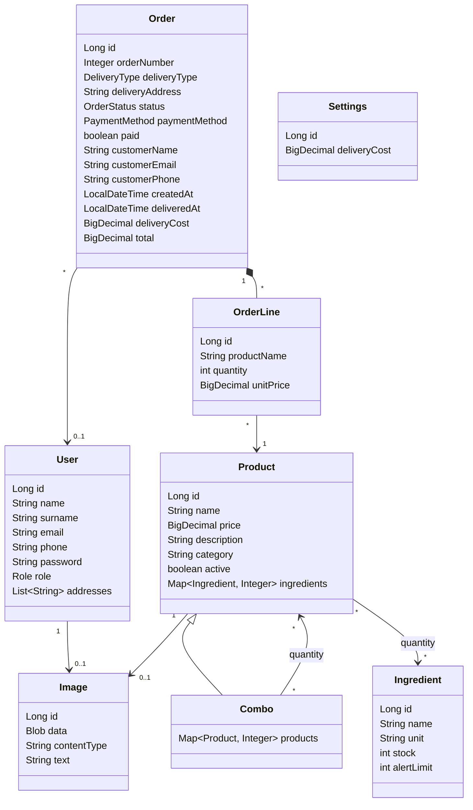
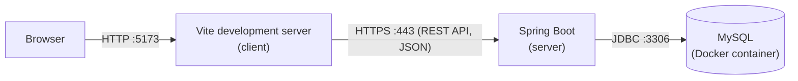
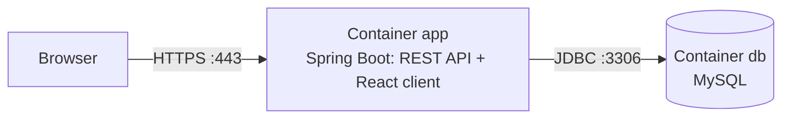
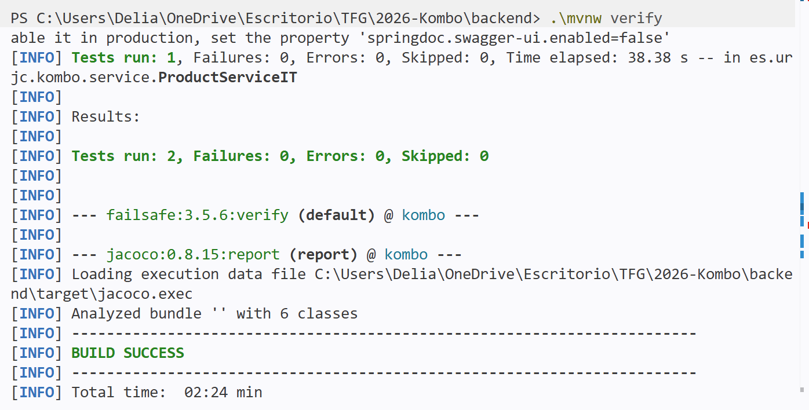
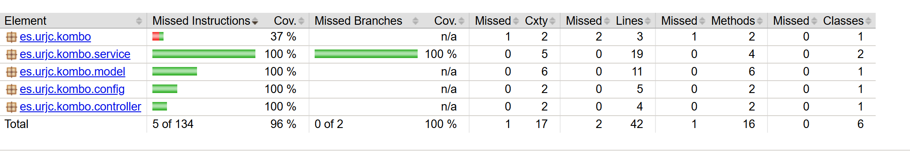
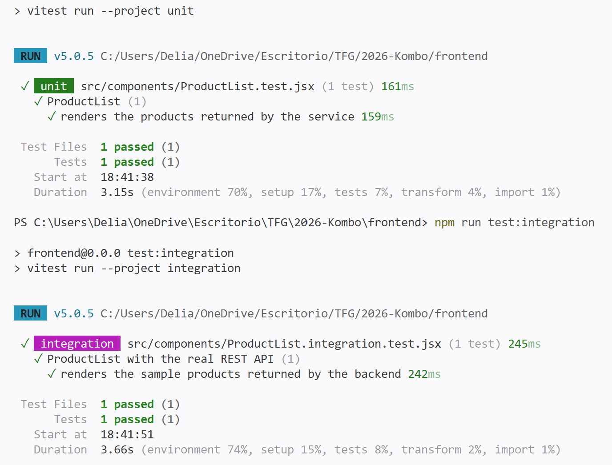
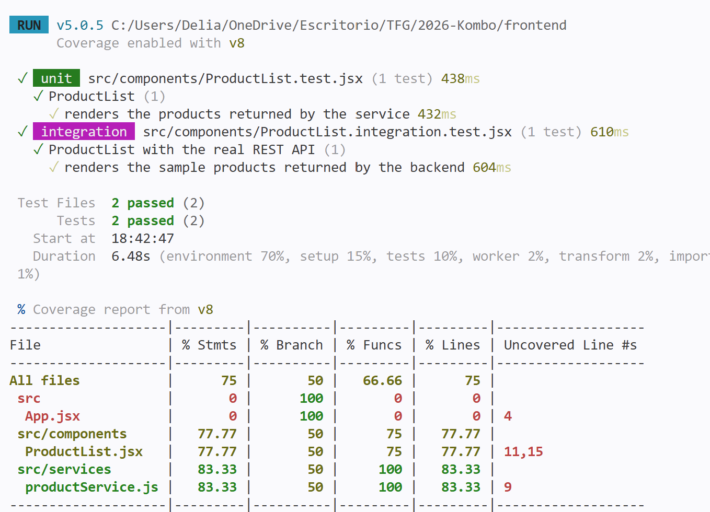
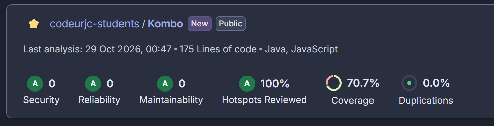
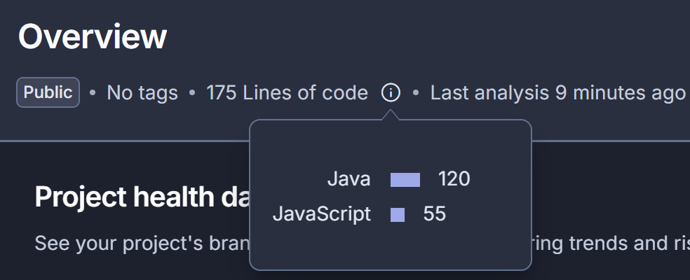

# Development guide

[← Back to README](../README.md)

- [Introduction](#introduction)
- [Technologies](#technologies)
- [Tools](#tools)
- [Architecture](#architecture)
  - [Domain model](#domain-model)
  - [Deployment](#deployment)
  - [Security](#security)
  - [Client](#client)
  - [REST API](#rest-api)
- [Quality control](#quality-control)
  - [Automated tests](#automated-tests)
  - [Static code analysis](#static-code-analysis)
- [Development process](#development-process)
  - [Task management](#task-management)
  - [Git](#git)
  - [Continuous integration](#continuous-integration)
  - [Continuous delivery](#continuous-delivery)
  - [Publishing a release](#publishing-a-release)
- [Running and editing the code](#running-and-editing-the-code)
  - [Cloning the repository](#cloning-the-repository)
  - [Configuration (environment variables)](#configuration-environment-variables)
  - [HTTPS certificate](#https-certificate)
  - [Running the application](#running-the-application)
  - [Running with Docker](#running-with-docker)
  - [Using the tools](#using-the-tools)
  - [Running the tests](#running-the-tests)

## Introduction

Kombo is a web application with a SPA (Single Page Application) architecture. In a SPA, the browser loads a single HTML page once and, from then on, the JavaScript code changes the content of the page and requests the data from the server through a REST API, without reloading the page. The application has three parts: the client (a SPA developed with React that runs in the browser), the server (a REST API developed with Spring Boot that contains the business logic and returns the data in JSON format) and the database (MySQL).

| | |
| :--- | :--- |
| **Type** | Web SPA with REST API |
| **Technologies** | Java, Spring Boot, MySQL, JavaScript, React |
| **Tools** | Visual Studio Code, Maven, Node.js and npm, Vite, Git, GitHub, Docker, Postman |
| **Quality control** | Unit, integration and system tests of server and client (JUnit, Mockito, Testcontainers, Rest Assured, Selenium, Vitest and Testing Library), test coverage (JaCoCo and Vitest), static code analysis (SonarQube Cloud) and continuous integration (GitHub Actions) |
| **Deployment** | Docker image (client and server in one Spring Boot jar, over HTTPS) published in DockerHub, run with Docker Compose together with MySQL |
| **Development process** | Iterative and incremental, Git with GitHub Flow, task management with GitHub Issues and GitHub Projects, continuous integration with GitHub Actions |

## Technologies

- **Java 21**: programming language of the server. https://www.java.com
- **Spring Boot 4.1**: framework used to develop the server. It provides the REST API (Spring Web MVC) and the access to the database (Spring Data JPA, with Hibernate). https://spring.io/projects/spring-boot
- **Spring Security 7**: authentication (BCrypt passwords, `UserDetailsService`) and access rules by role and owner. https://spring.io/projects/spring-security
- **JJWT**: creates and validates the JSON Web Token (JWT) of the session. https://github.com/jwtk/jjwt
- **springdoc-openapi**: generates the OpenAPI documentation of the REST API from the controllers and offers it with Swagger UI. https://springdoc.org
- **MySQL 8.4**: relational database where the server stores the data. https://www.mysql.com
- **React 19**: JavaScript library used to develop the client. https://react.dev
- **React Router 8**: navigation between the pages of the client (SPA) and protected routes. https://reactrouter.com
- **React Bootstrap 2 and Bootstrap 5.3**: responsive components of the client (navigation bar, forms, tables, alerts). https://react-bootstrap.netlify.app

## Tools

- **Visual Studio Code**: code editor, with the *Extension Pack for Java* and *Spring Boot Extension Pack* extensions. https://code.visualstudio.com
- **Maven**: dependency management and build of the server. It is used through the Maven Wrapper (`mvnw`) included in the repository. https://maven.apache.org
- **Node.js and npm**: runtime and package manager of the client. https://nodejs.org
- **Vite**: creates, runs and builds the client. In development, it forwards the requests to `/api` to the server. https://vite.dev
- **Git and GitHub**: version control and code repository. https://github.com
- **Docker and Docker Compose**: build the image of the application and run it with its database; also run the database during development and the databases of the integration tests. https://www.docker.com
- **Postman**: used to make requests to the REST API. https://www.postman.com
- **keytool**: tool of the JDK that generates the self-signed certificate (keystore) used for HTTPS. https://docs.oracle.com/en/java/javase/21/docs/specs/man/keytool.html
- **Redocly CLI**: generates the HTML documentation of the REST API from the OpenAPI specification. https://redocly.com/docs/cli
- **ESLint**: checks the JavaScript code of the client. https://eslint.org
- **SonarQube Cloud**: static code analysis service that detects bugs, vulnerabilities, code smells and duplicated code, and shows the test coverage. https://sonarcloud.io

## Architecture

### Domain model

The persistent entities of the server are in the package `es.urjc.kombo.model`. The [analysis](analysis.md) describes each attribute.



- **Combo extends Product** (single table inheritance), so a combo can be used wherever a product is expected. `getIngredientUsage()` returns the quantity of each ingredient used when one unit is sold; a combo overrides it to add up the ingredients of its products.
- **OrderLine** stores the name and the unit price of the product at the time of the purchase, so past orders and the cash register closing do not change if a product changes. It keeps the reference to the product for the ingredients used (inventory).
- **Order number**: `1000 + id`, given just after the order is saved (`Order.assignOrderNumber()`), so it is unique without a counter; the column has a unique constraint.
- **Settings** has a single row with the delivery cost of home deliveries, which the administrator can change. Home deliveries with a subtotal of 25 € or more (`Settings.FREE_DELIVERY_THRESHOLD`) do not pay it; the server always calculates it, never the client.
- The enumerations are declared inside the entity that uses them (`User.Role`, `Order.DeliveryType`, `Order.OrderStatus` and `Order.PaymentMethod`) and are stored as text.
- Images are stored in the database. They are loaded lazily, only when they are needed.

### Deployment

During development, each part of the application runs as an independent process:



- The browser loads the client from the Vite development server (port 5173).
- The client calls the REST API with requests to `/api`, which Vite forwards to the server over HTTPS (port 443). The data is exchanged in JSON format.
- The server only accepts HTTPS, with a self-signed certificate (see [HTTPS certificate](#https-certificate)).
- The server accesses the MySQL database (port 3306) with JDBC. The database runs in a Docker container.


With Docker, the client and the server are packaged in a single image (see [Running with Docker](#running-with-docker)):



- The image is built in three stages (`docker/Dockerfile`): the React client is built with Node.js, its static files are copied into the Spring Boot jar, and the final image only contains the Java runtime (JRE) and the jar.
- The server returns the client for `/` and for the client routes (`SpaConfig` returns `index.html` for any path that is not a file or `/api`), so the client and the REST API share the same origin and the session cookie works without CORS.
- Inside the container the server listens on port 8443 (a non-root user cannot use ports below 1024) and Docker Compose publishes it as port 443.

### Security

Users log in with their email and password. Passwords are stored encoded with BCrypt. Authentication is stateless: there is no HTTP session in the server.

1. The client sends `POST /api/v1/auth/login` with `{ "email", "password" }`.
2. The server checks them (`KomboUserDetailsService` loads the user, Spring Security compares the BCrypt hash) and answers with the user data and a JSON Web Token (JWT) signed with `KOMBO_JWT_SECRET`, in a cookie called `kombo_token`. The cookie is `HttpOnly` (JavaScript cannot read it, which protects it from XSS), `Secure` (only sent over HTTPS) and `SameSite=Strict` (not sent in requests started from other sites, which protects from CSRF). It expires after `KOMBO_JWT_EXPIRATION` (2 hours by default).
3. The browser sends the cookie in every request. `JwtAuthenticationFilter` validates the token and loads the user, with its role.
4. `POST /api/v1/auth/logout` deletes the cookie.

**Roles.** Every user has one role: `CUSTOMER`, `EMPLOYEE` or `ADMIN`. Customers and employees are stored in the database (the sample data creates `customer@kombo.com` and `employee@kombo.com`). There is only one administrator: `AdminInitializer` creates it when the application starts, with the email `KOMBO_ADMIN_EMAIL` and the BCrypt hash of the password `KOMBO_ADMIN_PASSWORD_HASH` (the plain password is never in the code or the configuration). Changing the variable and restarting changes the password; for the same reason, a password changed by the administrator in the profile settings goes back to the one of `KOMBO_ADMIN_PASSWORD_HASH` when the application restarts.

**Endpoints and access rules** (`SecurityConfig`, and `@PreAuthorize` and `OrderService` for the rules of each endpoint). Each user reads and changes their own account with the `/users/me` paths; the `/users/{id}` paths are only for the administrator, who can see and change the account of any user:

| Endpoint | Anonymous | Customer | Employee | Administrator |
| :--- | :---: | :---: | :---: | :---: |
| `POST /api/v1/auth/login`, `POST /api/v1/auth/logout` | ✓ | ✓ | ✓ | ✓ |
| `GET /api/v1/auth/me` (logged in user) | 401 | ✓ | ✓ | ✓ |
| `GET /api/v1/products/**` (menu, detail and picture) | ✓ | ✓ | ✓ | ✓ |
| `POST /api/v1/users` (sign up) | ✓ | ✓ | ✓ | ✓ |
| `PUT /api/v1/users/me`, `PUT /api/v1/users/me/password`, `PUT /api/v1/users/me/addresses`, `PUT`, `GET` and `DELETE /api/v1/users/me/image`, `GET /api/v1/users/me/orders` | 401 | ✓ | ✓ | ✓ |
| `DELETE /api/v1/users/me` (delete the account) | 401 | ✓ | ✓ | 403 |
| `GET /api/v1/users` and every `/api/v1/users/{id}` path (`GET`, `PUT` and `DELETE` of the user, addresses, picture and order history) | 401 | 403 | 403 | ✓ (403 to delete the administrator) |
| `POST /api/v1/admin/users` (create a customer or an employee) | 401 | 403 | 403 | ✓ (400 for the role `ADMIN`) |
| `GET /api/v1/settings` | ✓ | ✓ | ✓ | ✓ |
| `PUT /api/v1/settings` (delivery cost) | 401 | 403 | 403 | ✓ |
| `POST /api/v1/orders` (checkout and counter orders) | ✓ | ✓ | ✓ | 403 |
| `GET /api/v1/orders/{id}` | 401 | Only their own (403) | ✓ | ✓ |
| `GET /api/v1/orders` and `PATCH /api/v1/orders/{id}` (order dashboard) | 401 | 403 | ✓ | ✓ |

Errors 401 (not logged in, invalid or expired token, wrong credentials) and 403 (role not allowed or data of another user) have the same `ProblemDetail` format as the rest of the errors of the REST API.

### Client

The client is a React SPA. Its code is in `frontend/src`:

| Folder or file | Content |
| :--- | :--- |
| `main.jsx`, `App.jsx`, `routes.jsx` | Entry point, router (`createBrowserRouter`) and the routes of the application |
| `theme.css` | Design tokens: the palette, the typefaces and the Bootstrap variables, defined in a single place |
| `context/` | `AuthContext` and `AuthProvider`: session state (`user`, `loading`, `login`, `signUp`, `logout`, `refreshUser`) shared by every page; `CartContext`, `CartProvider` and `cartReducer`: the cart, kept in `localStorage` |
| `services/` | `httpClient.js` (common HTTP client: `credentials: 'include'`, JSON or `FormData` for file uploads, and `ApiError` with the status and the `detail` of the ProblemDetail) and one service per resource: `authService`, `productService`, `userService`, `orderService` and `settingsService` |
| `hooks/` | `usePagedList` (pages of a paginated resource, with loading, error, retry, the *Más resultados* button and a refresh without the loading state), `useRepeatOrder` (adds the products of an order to the cart), `useSettings` (delivery cost) and `useNow` (current time updated every few seconds, for the waiting time of the orders) |
| `components/` | `Layout` (navigation bar, content, footer and confirmation messages), `AppNavbar`, `ProtectedRoute`, `ProductList`, `ProductCard`, `OrderSummary`, `UserAvatar` (profile picture or initial), `AccountForms` (personal data, picture and addresses, shared by the profile settings and the user management), `DeleteUserModal`, `StatusPage`, `LoadingState` and `ErrorState` |
| `pages/` | One component per page (see the table below) |
| `utils/` | Formats (prices, dates, minutes and order status), delivery cost and the validation of the checkout and of the profile settings |

**Lists.** Lists with more than 10 items (menu, order history, order dashboard and users) show the first 10 and a *Más resultados* button that loads the next 10.

**Session.** The JWT is in an httpOnly cookie that JavaScript cannot read, so when the application starts `AuthProvider` asks `GET /api/v1/auth/me` who the user is. `ProtectedRoute` only shows its pages to logged in users with an allowed role: anonymous users are sent to the log in page (and back to the page they wanted after logging in) and other roles see a 403 page. The server checks the same rules; the client only avoids showing pages that would fail.

**Pages and navigation by role:**

| Route | Page | Anonymous | Customer | Employee | Administrator |
| :--- | :--- | :---: | :---: | :---: | :---: |
| `/` | Menu with category filter (`HomePage`) | ✓ | ✓ | ✓ | ✓ |
| `/products/{id}` | Product or kombo detail (`ProductDetailPage`) | ✓ | ✓ | ✓ | ✓ |
| `/login` | Sign up and log in (`LoginPage`) | ✓ | | | |
| `/cart` | Cart (`CartPage`) | ✓ | ✓ | ✓ | ✓ (without checkout) |
| `/checkout` | Checkout (`CheckoutPage`); *Pedido en mostrador* for employees | ✓ | ✓ | ✓ | |
| `/order-confirmation` | Confirmation with the order number (`OrderConfirmationPage`) | ✓ | ✓ | ✓ | |
| `/profile` | Profile of the customer with their last orders (`ProfilePage`); employees and the administrator are sent to `/profile/settings`, which their *Mi perfil* link opens directly | | ✓ | ✓ | ✓ |
| `/profile/settings` | Settings of the account (`ProfileSettingsPage`): personal data and picture, password, addresses (customers) and deletion of the account (not the administrator) | | ✓ | ✓ | ✓ |
| `/orders/{id}` | Order detail (`OrderDetailPage`): customers only their own | | ✓ | ✓ | ✓ |
| `/orders` | Order dashboard (`OrdersDashboardPage`) | | | ✓ | ✓ |
| `/admin/users` | Users (`UsersPage`): list with *Editar* and *Borrar* for customers and employees | | | | ✓ |
| `/admin/users/new` | New user (`NewUserPage`): customer or employee with their first password | | | | ✓ |
| `/admin/users/:id` | Edit a user (`UserEditPage`): personal data, picture, addresses of customers and deletion | | | | ✓ |
| `/admin/settings` | Delivery cost (`AdminSettingsPage`) | | | | ✓ |
| Any other | 404 page | ✓ | ✓ | ✓ | ✓ |

The navigation bar only shows the links of the role of the user, plus the name, the role and a *Cerrar sesión* (log out) button, always visible.

**Design.** The look comes from the Kombo logo: its oranges (`#f39a2b`, `#ea5d2f` and `#e5412a`) are the main colours, combined with a cool navy ink for text, a teal accent for roles and a warm off-white background. They are defined once in `theme.css`, together with the logo gradient. The logo (with transparent background) and the favicon are in `frontend/public` (`logo-horizontal.png`, `logo-icon.png`, `logo-vertical.png`, `favicon.ico`, `favicon.png` and `apple-touch-icon.png`). The headings use *Montserrat*, close to the letters of the logo, and the body text *DM Sans* (installed with npm, so they work without Internet). Buttons and orange text use a darker orange (`#cf4517`), because white text on the bright orange of the logo does not reach the WCAG AA contrast. The home page opens with an orange banner with the logo; each product card shows the picture (or the Kombo icon if it has none), its category, the name, a short description and the price in orange. Every page gives feedback: loading states (spinners and skeletons), errors with a *Retry* button, hover and keyboard focus states, and confirmation messages (for example, after logging in or out). The layout is responsive: the product grid adapts its columns, the navigation bar collapses into a menu on mobile and tables scroll horizontally. The 404, 403 and error pages use the same layout and style.

### REST API

The documentation of the REST API, generated with OpenAPI, can be seen here: [REST API documentation](https://raw.githack.com/codeurjc-students/2026-Kombo/main/docs/api/api-docs.html).

## Quality control

### Automated tests

The server and the client have unit, integration and system tests. The system tests of the REST API use HTTPS, with a temporary self-signed certificate and Rest Assured configured with `relaxedHTTPSValidation`. Every feature has the six types of tests required by the guide: server unit, server-database integration, REST API system, client unit, client-REST API integration and UI system (Selenium):

| Type | Part | Tool | Test | What it checks |
| :--- | :--- | :--- | :--- | :------------- |
| Unit | Server | JUnit and Mockito | `ProductServiceTest` | The service returns the pages of products, filters by category (a blank category is the whole menu), returns the detail of a product and of a combo (its products and the ingredients of all of them), returns the product image and fails when a product or its image does not exist, with the database mocked |
| Unit | Server | JUnit and Mockito | `UserServiceTest` | The sign up saves a customer with the encoded password, removes the spaces around the name and the email, stores empty optional fields as null and rejects an email that is already registered; the personal data changes but not the email (404 for an unknown user); the password changes only with the right current password; the addresses are replaced without blanks or repetitions; the picture is stored, read (404 without picture) and deleted; deleting an account keeps the orders without the customer, and the account of the administrator cannot be deleted, with the database mocked; the administrator creates an employee or a customer with the encoded password and a registered email is rejected |
| Unit | Server | JUnit | `ImageServiceTest` | A picture keeps its content and takes its type from its first bytes (JPEG, PNG, GIF and WebP), not from the type sent by the browser; an SVG or another file that is not a picture, an empty file and a file bigger than 1 MB are rejected; the content is read back |
| Integration | Server | JUnit and Testcontainers | `ProductServiceIT` | The service returns the active products, the combos in their category, the pages, the detail of products and combos and the images stored in a real MySQL database (without sample data) |
| Integration | Server | JUnit and Testcontainers | `UserServiceIT` | The sign up stores the customer with a BCrypt password in a real MySQL database and rejects a repeated email without saving it; the new personal data, the new password (encoded), the list of addresses and the profile picture are stored in the database, and the picture is deleted; deleting an account deletes the user and keeps their orders without the customer data; an employee created by the administrator is stored with their role and a BCrypt password |
| Integration | Server | JUnit and Testcontainers | `SampleDataLoaderIT` | The sample data (products, combos, ingredients, users of each role with encoded passwords and orders) is loaded once |
| Integration | Server | JUnit and Testcontainers | `SampleDataDisabledIT` | With `kombo.sample-data.enabled=false` no sample data is loaded, and the only user is the administrator created from the configuration |
| System | Server | JUnit and Rest Assured | `ProductApiIT` | The REST API returns the pages of sample products, the category filter, a page of a category, the product detail, the detail of a combo with its products and ingredients, the product image and the 400 and 404 errors |
| System | Server | JUnit and Rest Assured (HTTPS) | `UserApiIT` | Sign up: 201 with the `Location` header and without the password, the new customer can log in, 409 with a registered email, 400 with the invalid fields named in the detail, and the role cannot be chosen. Account: the personal data changes but not the email (400 with invalid fields, 401 without session); the password changes and the old one stops working (400 with a wrong current password); addresses added and deleted (400 for a blank one); the picture is uploaded, read (`no-cache`) and deleted (400 for a file that is not a picture, 413 for more than 1 MB); the account is deleted with the cookie and cannot log in again; the administrator changes the data, addresses and picture of any user and deletes any account but their own (403), and a customer gets 403 for the `/users/{id}` paths; the administrator creates an employee (201, `Location`, without the password) who can log in, gets 400 for the role `ADMIN` and 409 for a registered email, and anonymous users (401) and employees (403) cannot create users |
| Unit | Server | JUnit | `JwtServiceTest` | The JWT is created and validated, tokens with another key, expired or malformed are rejected, and the cookie is `HttpOnly`, `Secure` and `SameSite=Strict` |
| Unit | Server | JUnit and Mockito | `OrderServiceTest` | Dashboard: the orders of some statuses (or all) and from a date; the status only moves forward until the order is delivered or cancelled, a cash order is delivered only when it is paid and is marked as paid only once (never as not paid, never when cancelled), an update needs a change and an order that exists. Counter orders of an employee without email or phone, which customers and anonymous users must give. A customer can only read their own orders; employees and the administrator can read any order. Placing an order copies the current name and price of each product, gives the number `1000 + id`, adds the delivery cost only to home deliveries below 25 €, marks card payments as paid, saves the order in the history of a customer (not of an employee), and rejects a home delivery without address and a product that is not on the menu, with the database mocked; a new delivery address is saved in the profile of the customer only once, and the history of a user is read page by page (404 for an unknown user) |
| Unit | Server | JUnit and Mockito | `SettingsServiceTest` | The settings are created with the default delivery cost (2,50 €), the administrator changes it, and only home deliveries below the free delivery threshold pay it |
| Integration | Server | JUnit and Testcontainers | `OrderServiceIT` | A placed order is stored in a real MySQL database with its lines, a unique number and the price and name of the product at the time of the purchase, which do not change when the product changes; a customer finds only their orders, the newest first, and keeps the new delivery address in a real MySQL database; the dashboard finds the orders of the statuses oldest first and only the finished orders of today, and the changes of status and payment are stored |
| System | Server | JUnit and Rest Assured (HTTPS) | `OrderDashboardApiIT` | Employees read the pending orders oldest first and the finished ones; a cash order is prepared, not delivered before it is paid (409), charged and delivered, and is the most recent finished order of today (none from tomorrow, 400 for a wrong date); a cancelled order cannot change (409), an empty or wrong change returns 400 and an unknown order 404; anonymous users get 401 and customers 403; an employee places a counter order with only the name of the customer, and an anonymous user still needs an email |
| System | Server | JUnit and Rest Assured (HTTPS) | `OrderApiIT` | Whole checkout through HTTP: a customer places a home delivery (201, `Location`, prices and delivery cost from the server) and finds it with `GET /orders/{id}` and in their history; an anonymous order paid by card; 400 without address or with invalid fields; 403 for the administrator; only the administrator changes the delivery cost, which is used by the next orders; `GET /users/me/orders` returns the history of the logged in customer (newest first, 401 without session) and the new address is in their profile; another customer gets 403 for the order and an empty history |
| Unit | Server | JUnit and Mockito | `AdminInitializerTest` | The administrator is created or updated with the BCrypt hash of the configuration, and a plain password is rejected |
| System | Server | JUnit and Rest Assured (HTTPS) | `AuthApiIT` | Log in (cookie `HttpOnly`, `Secure` and `SameSite=Strict`), wrong credentials (401), `me` with and without session, invalid token (401) and log out |
| System | Server | JUnit and Rest Assured (HTTPS) | `SpaForwardingIT` | The server returns the client (`index.html`) for `/` and for the client routes, and keeps the 404 of unknown REST API endpoints and missing files |
| System | Server | JUnit and Rest Assured (HTTPS) | `AccessRulesApiIT` | 401 without login, 403 with a role that is not allowed, 403 for the `/users/{id}` paths to every user but the administrator (also with their own id), 403 for the order of another customer, and access of the owner (with `/auth/me` and `/users/me/orders`), employees and administrator |
| Unit | Client | Vitest and Testing Library | `ProductList.test.jsx` | The menu shows the products and their prices, filters by category and goes back to the whole menu with *Todo*, loads more pages, links each card to its detail page, shows errors with *Retry*, the empty state and the image fallback, with the service mocked and a virtual DOM |
| Unit | Client | Vitest | `httpClient.test.js`, `authService.test.js`, `productService.test.js`, `userService.test.js` | The HTTP client sends the cookie (`credentials: 'include'`), JSON and `FormData` (multipart) and turns errors into `ApiError`; each service calls its endpoints (also the account, addresses, picture and deletion of the user) |
| Unit | Client | Vitest and Testing Library | `ProfileSettingsPage.test.jsx`, `profileValidation.test.js` | The settings show the name, email and tabs of each role (no addresses for employees, no deletion for the administrator); the personal data is saved on its own (the email cannot be changed, *Volver al perfil* saves nothing, wrong fields and server errors are shown); the password changes and the wrong current password is marked; a picture is uploaded or removed and a file that is not a picture or is too big is rejected; addresses are added (not empty or repeated) and deleted; the account is deleted only after the confirmation, which closes the session; the validation of each field |
| Unit | Client | Vitest and Testing Library | `OrdersDashboardPage.test.jsx`, `format.test.js` | The dashboard shows the pending orders oldest first with the minutes they have been waiting (red after 10, and they keep counting) and the finished ones of today with their time, and reads both lists again every 30 seconds without hiding them or closing an open confirmation; it marks an order as ready, charges a cash order (which is delivered only when paid), delivers it and cancels it after the confirmation, reloading the lists; 409 and other errors, empty lists and the counter order button; only for employees and the administrator. The minutes and times are formatted |
| Unit | Client | Vitest and Testing Library | `AuthProvider.test.jsx` | The session is read on startup, and log in, sign up (which logs in afterwards) and log out update it |
| Unit | Client | Vitest | `cartReducer.test.js` | The logic of the cart: add, sum the units of the same product, change the units (0 removes the product, at most 99), remove, empty, count and subtotal without rounding errors |
| Unit | Client | Vitest and Testing Library | `CartProvider.test.jsx` | The cart adds products, changes their units, removes them and empties, is kept in `localStorage` (it survives a reload) and starts empty or skips the items when the stored cart is not valid |
| Unit | Client | Vitest and Testing Library | `CartPage.test.jsx` | The cart page shows the products and only the subtotal (the delivery type is chosen in the checkout) with a note on the delivery cost of home deliveries, changes the units and removes products, the empty cart, the cart when the delivery cost cannot be loaded and the administrator without the checkout button |
| Unit | Client | Vitest and Testing Library | `CheckoutPage.test.jsx`, `checkoutValidation.test.js`, `orderService.test.js` | The checkout places a home delivery paid by card (without sending the card data), shows the order number and empties the cart; it shows the wrong fields, starts with the data of the customer, pays in cash, shows the server errors and sends an empty cart back to the cart page; the validation of each field and the simulated card; the order and settings services (also the dashboard filters and the change of an order); an employee places a counter order with only the name of the customer and without card data, and goes to the orders from the confirmation; a customer sees their saved data instead of the form (with *Cambiar*), the form opens when the saved data is not complete, the page waits for the session, and a saved address or a new one (which reads the session again) is chosen |
| Unit | Client | Vitest and Testing Library | `AdminSettingsPage.test.jsx` | The administrator changes the delivery cost; errors when it cannot be loaded or saved; the page is only for the administrator |
| Unit | Client | Vitest and Testing Library | `ProductDetailPage.test.jsx` | The detail page shows the picture, price, description and ingredients, the products of a combo with links, adds the product to the cart and updates the counter of the navigation bar, and shows the image fallback, the 404 page and errors with *Reintentar* |
| Unit | Client | Vitest and Testing Library | `AppNavbar.test.jsx`, `ProtectedRoute.test.jsx` | The navigation bar shows the links of each role and logs out; protected routes redirect anonymous users to the log in page and show 403 to other roles |
| Unit | Client | Vitest and Testing Library | `LoginPage.test.jsx`, `ProfilePage.test.jsx`, `UsersPage.test.jsx`, `StatusPages.test.jsx` | Log in with redirection by role (employees to the order dashboard) and error messages, sign up (logged in and sent to the profile, different passwords, registered email and invalid data), profile and order history, users list with pages, and the 404 and error pages |
| Unit | Client | Vitest and Testing Library | `UsersPage.test.jsx`, `NewUserPage.test.jsx`, `UserEditPage.test.jsx`, `profileValidation.test.js`, `userService.test.js` | The users list has *Editar* and *Borrar* for customers and employees but not for the administrator, and deletes a user only after the confirmation, reading the list again (or shows the error); the new user page creates an employee or a customer (not an administrator) and goes back to the list, shows the wrong fields without calling the server and the errors of the server (409, 400 and others); the edit page changes the personal data, the picture and the addresses of a customer (an employee has no addresses), deletes the user and goes back to the list, and shows the 404 page and an error that can be retried; the validation of a new user and the administrator endpoints of the service |
| Unit | Client | Vitest and Testing Library | `ProfilePage.test.jsx`, `OrderDetailPage.test.jsx` | The profile shows the last 4 orders of the customer with a link to their detail and *Más resultados*; the detail shows the products with the price paid, delivery, payment and totals, 403 for the order of another user, 404 and errors with *Reintentar*; *Repetir pedido* (in the profile and in the detail, only for customers) adds the products to the cart with the current prices |
| Integration | Client | Vitest and Testing Library | `ProductList.integration.test.jsx` | The component shows the list of products obtained from the real REST API, filters the *Kombos* category and loads the next products with *Más resultados* |
| Integration | Client | Vitest | `authService.integration.test.js` | Log in with a sample user and 401 with a wrong password, against the real REST API |
| Integration | Client | Vitest and Testing Library | `ProductDetailPage.integration.test.jsx` | The detail page shows the ingredients of a sample product, the products of a sample combo and the 404 page, with the real REST API |
| Integration | Client | Vitest | `userService.integration.test.js` | Against the real REST API: sign up of a new customer who can then log in, and 409 with a registered email; a new customer changes their personal data (not the email) and their password (400 with a wrong one), adds and deletes addresses, uploads, reads and deletes a picture (400 for a file that is not a picture) and deletes their account. It runs in Node.js instead of jsdom, because the `fetch` of Node.js only sends its own `FormData`; the administrator creates an employee, changes their data, uploads and deletes their picture and deletes them (404 afterwards), creates a customer and changes their addresses, and gets 400 for the role `ADMIN`; a customer gets 403 |
| Integration | Client | Vitest | `orderService.integration.test.js` | Against the real REST API, the sample employee places a counter order with only the name of the customer, finds it pending, cannot deliver it before charging it (409), charges it and delivers it, and finds it as the most recent finished order of today; a customer gets 403 for the dashboard. `test-session.js` keeps the session cookie of a new customer or of a sample user |
| Integration | Client | Vitest and Testing Library | `CheckoutPage.integration.test.jsx` | The checkout places a home delivery paid in cash with the real REST API and shows the number and the total (with the delivery cost) calculated by the server; a new customer orders with their saved data and the new address is kept in their profile |
| Integration | Client | Vitest and Testing Library | `OrderDetailPage.integration.test.jsx` | With the real REST API, the profile of a new customer shows their order and opens its detail; another customer gets 403 for it. The tests keep the session cookie with `test-session.js`, because Node.js has no cookie store |
| System | Client | JUnit and Selenium | `ProductListE2E` | The sample products are shown on the home page of a real browser, 10 at first and the rest after *Más resultados*, and the *Kombos* category shows only the 3 combos |
| System | Client | JUnit and Selenium | `LoginE2E` | A customer logs in, sees their orders and logs out; a wrong password shows an error; anonymous users are sent to the log in page |
| System | Client | JUnit and Selenium | `ProductDetailE2E` | From the menu, the detail of a product shows its picture and ingredients and adds it to the cart (kept after reloading); the detail of a combo lists its products with links; an unknown product shows the 404 page |
| System | Client | JUnit and Selenium | `SignUpE2E` | A new customer signs up and is logged in on their profile; a registered email and different passwords show an error |
| System | Client | JUnit and Selenium | `CheckoutE2E` | From the menu to the confirmation: products added to the cart, only the subtotal in the cart page, delivery cost (free from 25 €) and total in the checkout, home delivery paid by card, order number and empty cart; the checkout shows the wrong fields; the sample customer orders with their saved data and address |
| System | Client | JUnit and Selenium | `OrderHistoryE2E` | The sample customer sees at most 4 orders in the profile, opens one, sees its detail and repeats it; the *Repetir pedido* button of the profile fills the cart |
| System | Client | JUnit and Selenium | `ProfileSettingsE2E` | A new customer changes their personal data (the email is disabled) and sees it in the profile; a wrong phone is shown and not saved; changes the password and logs in with the new one; adds and deletes addresses; uploads a picture and removes it; deletes the account, which cannot log in again |
| System | Client | JUnit and Selenium | `UserManagementE2E` | The administrator creates an employee from the users page, who logs in and goes to the order dashboard; the administrator edits the name of an employee and deletes them after the confirmation |
| System | Client | JUnit and Selenium | `OrderDashboardE2E` | The sample employee logs in to the dashboard, places a counter order from the menu with only the name of the customer, finds it pending with its waiting minutes, charges it, marks it as ready and delivers it, and finds it first in *Terminados* with its time; cancels an order after the confirmation; customers get the 403 page |

The Selenium tests share their setup in `E2ETestSupport`: headless Chrome with a fixed window size, clicks without scroll animation, and a screenshot and the HTML of the page of every failed test in `backend/target/e2e-failures` (in CI, the `e2e-failures` artifact of the run).

Statistics (22 November 2026; the screenshots below are from Phase 2):

| | Server | Client | Total |
| :--- | :---: | :---: | :---: |
| Number of tests | 187 (66 unit, 95 integration and REST API system, 26 Selenium) | 198 (175 unit, 23 integration) | 385 |
| Line coverage | 89.4 % (JaCoCo, `./mvnw verify`) | 98.1 % (unit tests, `npm run test:coverage`) | |









### Static code analysis

The code is analysed with [SonarQube Cloud](https://sonarcloud.io/project/overview?id=codeurjc-students_2026-Kombo) on every push, in the basic quality control workflow. The analysis includes the coverage of all the server tests and of the client unit tests (the client integration and system tests need the server running, so they are not included). The configuration is in `sonar-project.properties`.

| Security | Reliability | Maintainability | Security hotspots reviewed | Coverage | Duplications |
| :---: | :---: | :---: | :---: | :---: | :---: |
| A (0 issues) | A (0 issues) | A (0 issues) | 100 % | 70.7 % | 0.0 % |



Code size (lines of code, without blank lines and comments, measured by SonarQube Cloud):

<!-- TODO: update with the values of SonarQube Cloud -->
| Language | Lines of code |
| :--- | :---: |
| Java | 120 |
| JavaScript | 55 |
| **Total** | **175** |



## Development process

The development follows an iterative and incremental process, which follows the principles of the Agile Manifesto and is supported by some of the good practices of Extreme Programming (XP) and Kanban.

### Task management

The tasks are managed with GitHub Issues and a GitHub Projects board with a Kanban view (*Todo*, *In Progress* and *Done*). Each phase has a milestone, and each issue is closed with the pull request that completes it.

### Git

The code is stored in a Git repository on GitHub. The branching strategy is GitHub Flow:

- `main`: stable branch. No direct commits are made on it: the changes are merged through pull requests, and only if the full quality control passes.
- Feature branches: each task is developed in a branch with a short descriptive name in English (for example, `add-backend-tests`), which is merged into `main` with a pull request.

| Metric | Value (25 October 2026) |
| :--- | :---: |
| Commits in `main` | 22 |
| Branches | 9 |
| Pull requests merged | 7 |

### Continuous integration

The continuous integration is done with two GitHub Actions workflows:

- **Basic quality control** (`.github/workflows/ci-basics.yml`): runs on every commit to a feature branch (and also on `main`, so that SonarQube Cloud analyses the main branch). It builds the server and runs its unit tests, builds the client, checks it with ESLint and runs its unit tests, and analyses the code with SonarQube Cloud.
- **Full quality control** (`.github/workflows/ci-full.yml`): runs when a pull request to `main` is opened or updated. It runs the unit, integration and system tests of the server and the client. The client integration tests and the Selenium tests run against the application started with `docker compose` (`docker/docker-compose-dev.yml --build`, the same image that is published, built from the code of the pull request) at https://localhost, with a `.env` file of test-only values. The `main` branch is protected so that the pull request cannot be merged if this workflow fails.

### Continuous delivery

The Docker image is published in DockerHub (`deliaml10/kombo`) by the **Continuous delivery** workflow (`.github/workflows/cd.yml`). The workflow only decides the tags; the build and the push are done by the reusable workflow `.github/workflows/docker-publish.yml` (`workflow_call`), so the logic is not duplicated:

| Trigger | Image tags | Other |
| :--- | :--- | :--- |
| Push to `main` (merged pull request) | `dev` | `docker/docker-compose.yml` published as an OCI artifact in `deliaml10/kombo-compose:dev`, pointing to the image `dev` |
| Published GitHub release (for example `0.1.0` or `v0.1.0`) | `0.1.0` and `latest` | Compose OCI artifact `deliaml10/kombo-compose:0.1.0` and `deliaml10/kombo-compose:latest`, both pointing to the image `0.1.0` |
| Manual run (*Actions → Continuous delivery → Run workflow*, choosing a branch) | `<branch>-<yyyymmddhhmm>-<commit>` (UTC), for example `add-login-page-202611091352-3f2a9c1` (`/` in the branch name becomes `-`) | |

The workflow needs two repository secrets, created in GitHub in *Settings → Secrets and variables → Actions → New repository secret* (repository administrator permissions are needed):

| Secret | Value |
| :--- | :--- |
| `DOCKERHUB_USERNAME` | DockerHub user (`deliaml10`) |
| `DOCKERHUB_TOKEN` | DockerHub access token with *Read & Write* permission, created in DockerHub in *Account settings → Personal access tokens* (never the password) |

The published Compose application can be run without cloning the repository, with a `.env` file in the current folder:

```
docker compose -f oci://docker.io/deliaml10/kombo-compose:0.1.0 up -d
```

### Publishing a release

1. Merge into `main` all the pull requests of the version, with the full quality control in green.
2. In `CHANGELOG.md`, move the changes of `[Unreleased]` to a section with the version and date (in a pull request).
3. In GitHub, *Releases → Draft a new release*: create the tag (for example `0.1.0`) on `main`, use the version as title and the changelog section as description, and press *Publish release*.
4. The Continuous delivery workflow publishes the images `deliaml10/kombo:0.1.0` and `deliaml10/kombo:latest` and the Compose artifacts `deliaml10/kombo-compose:0.1.0` and `deliaml10/kombo-compose:latest`. Check it in *Actions* and in DockerHub.
5. Try it: `docker compose -f oci://docker.io/deliaml10/kombo-compose:0.1.0 up -d` and open https://localhost.

## Running and editing the code

### Cloning the repository

```
git clone https://github.com/codeurjc-students/2026-Kombo.git
cd 2026-Kombo
```

### Configuration (environment variables)

Secrets are never in the code. The application reads them from environment variables or from a `.env` file in the root of the repository, which Git ignores. Create it from the example and change the values:

```
cp .env.example .env
```

| Variable | Required | Description |
| :--- | :---: | :--- |
| `KOMBO_DB_PASSWORD` | Yes | Password of the MySQL `root` user (the database container is created with it) |
| `KOMBO_DB_URL`, `KOMBO_DB_USERNAME` | No | JDBC URL and user of the database (default `jdbc:mysql://localhost:3306/kombo` and `root`) |
| `KOMBO_ADMIN_EMAIL` | No | Email of the administrator (default `admin@kombo.com`) |
| `KOMBO_ADMIN_PASSWORD_HASH` | Yes | BCrypt hash of the password of the administrator. In `.env`, every `$` is written as `$$` (see below) |
| `KOMBO_JWT_SECRET` | Yes | Key used to sign the session JWT, at least 32 characters (for example `openssl rand -base64 48`) |
| `KOMBO_JWT_EXPIRATION` | No | Duration of the session, ISO-8601 format (default `PT2H`, 2 hours) |
| `KOMBO_SSL_KEY_STORE` | No | Location of the keystore (default `file:certs/kombo-keystore.p12`, relative to the folder where the server runs) |
| `KOMBO_SSL_KEY_STORE_PASSWORD` | Yes | Password of the keystore |
| `SERVER_PORT` | No | HTTPS port (default `443`) |
| `KOMBO_SAMPLEDATA_ENABLED` | No | `false` to start without sample data |

To generate the BCrypt hash of the administrator password (with Docker, or with the `htpasswd` tool of Apache):

```
docker run --rm httpd:2.4-alpine htpasswd -nbBC 10 "" "your-password" | tr -d ':\n'
```

Docker Compose reads `$` as the start of a variable, so in the `.env` file every `$` of the hash is written as `$$` (for example `$$2y$$10$$...`). The server undoes this escape, so the same file works for Docker Compose and for `./mvnw spring-boot:run`. The `.env.example` file contains the hash of the password `admin`, only for local development.

### HTTPS certificate

The server only listens on HTTPS (port 443). For local development it uses a self-signed certificate, generated once with `keytool` (included in the JDK), from the `backend` folder, using the password of `KOMBO_SSL_KEY_STORE_PASSWORD`:

```
keytool -genkeypair -alias kombo -keyalg RSA -keysize 2048 -validity 3650 -storetype PKCS12 -keystore certs/kombo-keystore.p12 -storepass <KOMBO_SSL_KEY_STORE_PASSWORD> -dname "CN=localhost" -ext "SAN=dns:localhost,ip:127.0.0.1"
```

The `certs` folder is ignored by Git. As the certificate is not signed by a known authority, the browser shows a warning the first time (*Advanced* → *Continue to localhost*), and Postman needs *SSL certificate verification* disabled. The automated tests generate their own temporary certificate (`keytool-maven-plugin` in `pom.xml`), so they need no configuration.

On Linux and macOS, port 443 needs administrator permissions: use `sudo` or change the port with `SERVER_PORT=8443` (and `KOMBO_BACKEND_URL=https://localhost:8443` for the client).

### Running the application

1. Create the `.env` file and the certificate (see the two sections above).

2. Run the database with Docker (Docker Desktop on Windows and Mac, Docker and Docker Compose on Linux), from the root of the repository:

   ```
   docker compose --env-file .env -f docker/docker-compose-db.yml up -d
   ```

   If the database was created before with another password, recreate it with `down -v` (this deletes its data).

3. Run the server, from the `backend` folder (Java 21 is required):

   ```
   ./mvnw spring-boot:run
   ```

   On Windows PowerShell: `.\mvnw spring-boot:run`. The REST API is at https://localhost/api/v1.

4. Run the client, from the `frontend` folder, in another terminal (Node.js is required):

   ```
   npm install
   npm run dev
   ```

5. Open the web application at http://localhost:5173. Vite forwards `/api` to https://localhost (`KOMBO_BACKEND_URL` changes it).

### Running with Docker

Only Docker is needed (Docker Desktop on Windows and Mac). From the root of the repository:

1. Create the `.env` file from `.env.example` (see [Configuration](#configuration-environment-variables)).
2. Run the application with one of the two Compose files:

   | File | Image | Use |
   | :--- | :--- | :--- |
   | `docker/docker-compose.yml` | `deliaml10/kombo:0.1` | Version 0.1, published in DockerHub |
   | `docker/docker-compose-dev.yml` | `deliaml10/kombo:dev` | Last version of `main`, published by CI, or built from the local code with `--build` |

   ```
   docker compose --env-file .env -f docker/docker-compose.yml up -d
   docker compose --env-file .env -f docker/docker-compose-dev.yml up -d
   docker compose --env-file .env -f docker/docker-compose-dev.yml up -d --build
   ```

   `--env-file .env` is needed because Docker Compose looks for the `.env` file in the folder of the Compose file (`docker/`), and the `.env` file is in the root of the repository.

3. Open https://localhost: the client and the REST API (https://localhost/api/v1, Swagger UI at https://localhost/swagger-ui.html) are served by the same container. The certificate is self-signed, so the browser shows a warning the first time.

Each Compose file runs two services:

- `db`: MySQL 8.4 with its data in a volume. Its *healthcheck* connects with the `mysql` client over TCP, so it only passes when the real server is ready (while MySQL creates the database it runs a temporary server without network), and `app` waits for it (`depends_on: condition: service_healthy`).
- `app`: the Kombo image, configured only with environment variables taken from `.env`: `KOMBO_DB_PASSWORD`, `KOMBO_ADMIN_EMAIL`, `KOMBO_ADMIN_PASSWORD_HASH`, `KOMBO_JWT_SECRET`, `KOMBO_SSL_KEY_STORE_PASSWORD` and `KOMBO_SAMPLEDATA_ENABLED`. Compose stops with a clear message if a required variable is missing.

**HTTPS certificate in Docker.** When the container starts, `docker/entrypoint.sh` generates a self-signed keystore with `keytool` if there is none, and keeps it in the `certs` volume, so no private key is stored in the image or in Git. To use your own certificate, mount a PKCS12 keystore with the alias `kombo` in `/app/certs/kombo-keystore.p12` (or point `KOMBO_SSL_KEY_STORE` to it).

Other useful commands:

```
docker compose -f docker/docker-compose.yml logs -f app   # logs of the application (same -f for the next commands)
docker compose -f docker/docker-compose.yml down      # stops and removes the containers (the data is kept)
docker compose -f docker/docker-compose.yml down -v   # also deletes the data and the certificate
docker build -f docker/Dockerfile -t deliaml10/kombo:dev .   # builds the image without Compose
```

### Sample data

When the server starts with an empty database, it loads sample data (class `SampleDataLoader`, in `es.urjc.kombo.config`):

- 15 ingredients with their stock (*Bacon* starts below its alert limit, to show a low stock ingredient).
- 9 products in the categories *Burgers*, *Sides*, *Drinks* and *Desserts*, each one with its ingredients and quantities, and 3 combos, shown as *kombos* (*Kombo clásico*, *Kombo de pollo* and *Kombo familiar*). The names, descriptions and units of the products and ingredients are in Spanish, because the application shows them to the users; the code and the keys of the products are in English.
- A customer and an employee, with the password encoded with BCrypt (the administrator is not sample data: it is created from the configuration, see [Security](#security)):

  | Role | Email | Password |
  | :--- | :--- | :--- |
  | Customer | `customer@kombo.com` | `customer` |
  | Employee | `employee@kombo.com` | `employee` |
  | Administrator | `KOMBO_ADMIN_EMAIL` (`admin@kombo.com`) | The one of `KOMBO_ADMIN_PASSWORD_HASH` (`admin` with `.env.example`) |

- 4 orders, of the customer and of anonymous users, in every status.
- The pictures of the products, read from `backend/src/main/resources/sample-images/` and stored in the database. The [README of that folder](../backend/src/main/resources/sample-images/README.md) lists the expected files; a product without its file is loaded without picture.

The loading is controlled by the property `kombo.sample-data.enabled` (in `application.properties`), which is `true` by default. If the database already has products, nothing is loaded again. To run the server without loading the sample data, so that the database is not modified:

```
./mvnw spring-boot:run -Dspring-boot.run.arguments=--kombo.sample-data.enabled=false
```

When the application is run from the jar, the argument is `--kombo.sample-data.enabled=false`, and as an environment variable `KOMBO_SAMPLEDATA_ENABLED=false`.

### Using the tools

- **Visual Studio Code**: open the root folder of the repository. The Java extensions detect the Maven project of the `backend` folder automatically.
- **Postman**: import the collection [kombo.postman_collection.json](api/kombo.postman_collection.json), which contains example requests to all the operations of the REST API. The `baseUrl` variable points to `https://localhost`. Disable *SSL certificate verification* in the Postman settings (self-signed certificate) and run *Auth → Log in* first: Postman keeps the session cookie and sends it in the next requests. The `email` and `password` variables choose the user.
- **Swagger UI**: with the server running, the REST API can also be tried at https://localhost/swagger-ui.html.
- **REST API documentation**: when the REST API changes, the files in `docs/api` are generated again, with the server running:

  ```
  curl -k -o docs/api/api-docs.yaml https://localhost/v3/api-docs.yaml
  npx @redocly/cli build-docs docs/api/api-docs.yaml -o docs/api/api-docs.html
  ```

### Running the tests

| Command | Folder | Tests | Requirements |
| :--- | :--- | :--- | :--- |
| `./mvnw test` | `backend` | Server unit tests | |
| `./mvnw verify` | `backend` | Server unit, integration and system tests, and coverage report (`target/site/jacoco/index.html`) | Docker running |
| `./mvnw verify -Pe2e` | `backend` | Client system test (Selenium) | Database, server and client running, and Google Chrome |
| `npm test` | `frontend` | Client unit tests | |
| `npm run test:integration` | `frontend` | Client integration tests | Server running (on https://localhost, or the address of `KOMBO_BACKEND_URL`) |
| `npm run coverage` | `frontend` | Client unit and integration tests with coverage report (`coverage/index.html`) | Server running |
