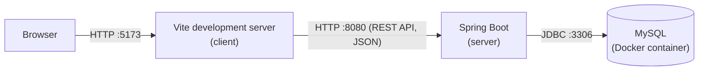
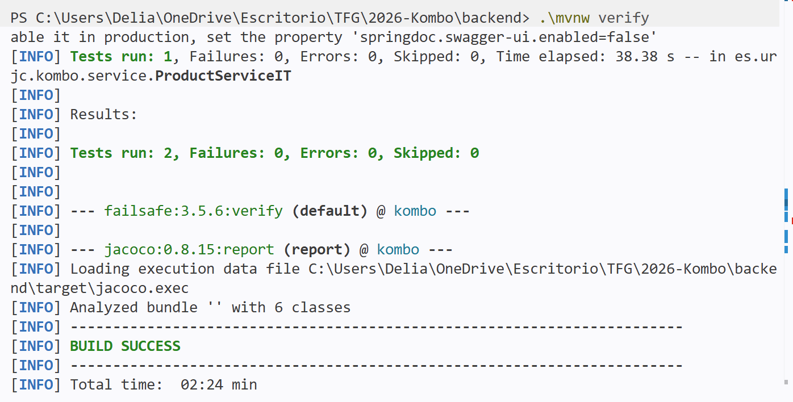
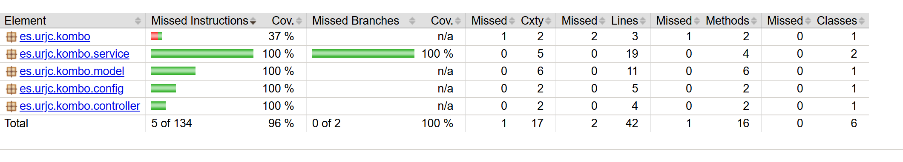
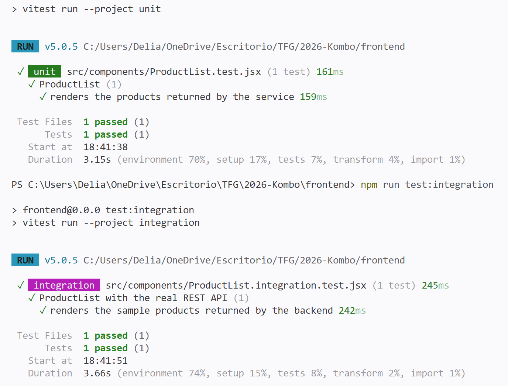
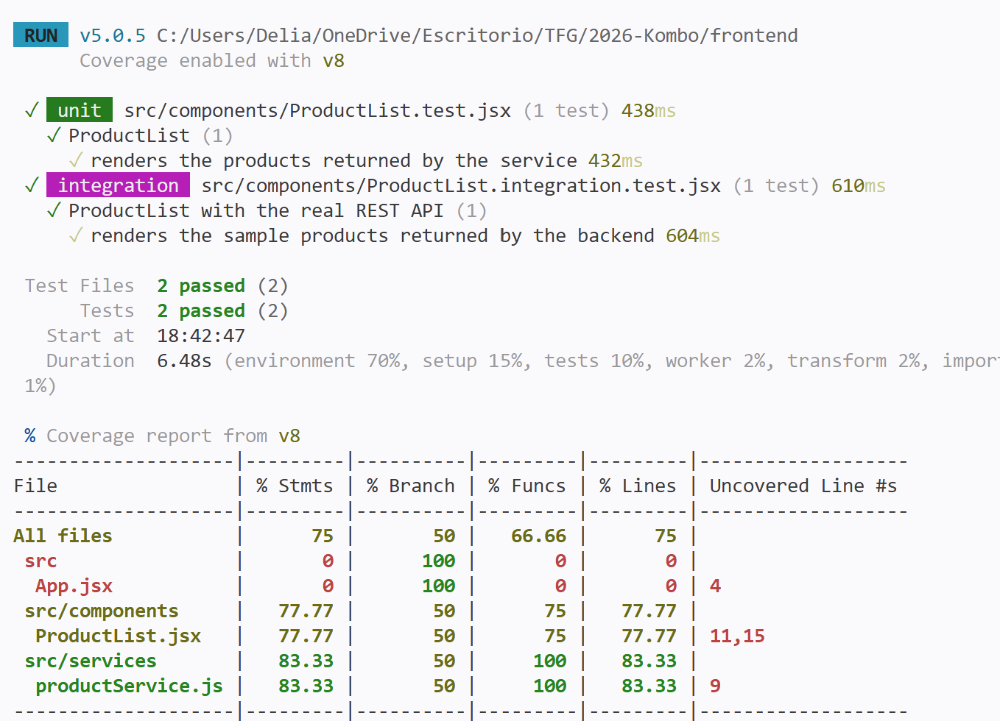
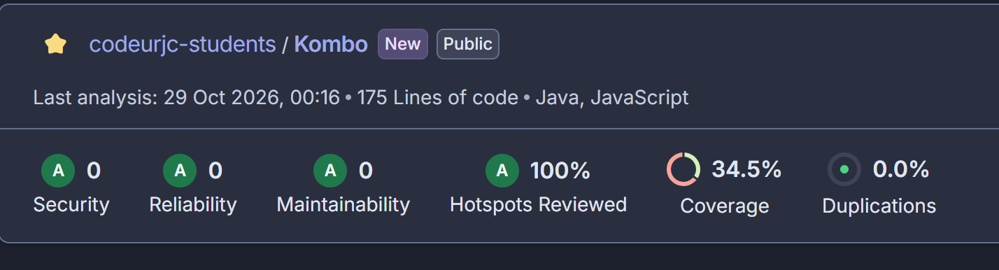
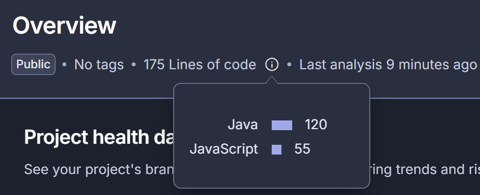

# Development guide

[← Back to README](../README.md)

- [Introduction](#introduction)
- [Technologies](#technologies)
- [Tools](#tools)
- [Architecture](#architecture)
  - [Deployment](#deployment)
  - [REST API](#rest-api)
- [Quality control](#quality-control)
  - [Automated tests](#automated-tests)
  - [Static code analysis](#static-code-analysis)
- [Development process](#development-process)
  - [Task management](#task-management)
  - [Git](#git)
  - [Continuous integration](#continuous-integration)
- [Running and editing the code](#running-and-editing-the-code)
  - [Cloning the repository](#cloning-the-repository)
  - [Running the application](#running-the-application)
  - [Using the tools](#using-the-tools)
  - [Running the tests](#running-the-tests)

## Introduction

Kombo is a web application with a SPA (Single Page Application) architecture. In a SPA, the browser loads a single HTML page once and, from then on, the JavaScript code changes the content of the page and requests the data from the server through a REST API, without reloading the page. The application has three parts: the client (a SPA developed with React that runs in the browser), the server (a REST API developed with Spring Boot that contains the business logic and returns the data in JSON format) and the database (MySQL).

| | |
| :--- | :--- |
| **Type** | Web SPA with REST API |
| **Technologies** | Java, Spring Boot, MySQL, JavaScript, React |
| **Tools** | Visual Studio Code, Maven, Node.js and npm, Vite, Git, GitHub, Docker, Postman |
| **Quality control** | Unit, integration and system tests of server and client (JUnit, Mockito, Testcontainers, Rest Assured, Selenium, Vitest and Testing Library), test coverage (JaCoCo and Vitest), static code analysis (SonarQube Cloud) and continuous integration (GitHub Actions) |
| **Deployment** | The application is not packaged yet. During development, the database runs in a Docker container |
| **Development process** | Iterative and incremental, Git with GitHub Flow, task management with GitHub Issues and GitHub Projects, continuous integration with GitHub Actions |

## Technologies

- **Java 21**: programming language of the server. https://www.java.com
- **Spring Boot 4.1**: framework used to develop the server. It provides the REST API (Spring Web MVC) and the access to the database (Spring Data JPA, with Hibernate). https://spring.io/projects/spring-boot
- **springdoc-openapi**: generates the OpenAPI documentation of the REST API from the controllers and offers it with Swagger UI. https://springdoc.org
- **MySQL 8.4**: relational database where the server stores the data. https://www.mysql.com
- **React 19**: JavaScript library used to develop the client. https://react.dev

## Tools

- **Visual Studio Code**: code editor, with the *Extension Pack for Java* and *Spring Boot Extension Pack* extensions. https://code.visualstudio.com
- **Maven**: dependency management and build of the server. It is used through the Maven Wrapper (`mvnw`) included in the repository. https://maven.apache.org
- **Node.js and npm**: runtime and package manager of the client. https://nodejs.org
- **Vite**: creates, runs and builds the client. In development, it forwards the requests to `/api` to the server. https://vite.dev
- **Git and GitHub**: version control and code repository. https://github.com
- **Docker**: runs the database in a container during development and the databases of the integration tests. https://www.docker.com
- **Postman**: used to make requests to the REST API. https://www.postman.com
- **Redocly CLI**: generates the HTML documentation of the REST API from the OpenAPI specification. https://redocly.com/docs/cli
- **ESLint**: checks the JavaScript code of the client. https://eslint.org
- **SonarQube Cloud**: static code analysis service that detects bugs, vulnerabilities, code smells and duplicated code, and shows the test coverage. https://sonarcloud.io

## Architecture

### Deployment

During development, each part of the application runs as an independent process:



- The browser loads the client from the Vite development server (port 5173).
- The client calls the REST API with HTTP requests to `/api`, which Vite forwards to the server (port 8080). The data is exchanged in JSON format.
- The server accesses the MySQL database (port 3306) with JDBC. The database runs in a Docker container.

### REST API

The documentation of the REST API, generated with OpenAPI, can be seen here: [REST API documentation](https://raw.githack.com/codeurjc-students/2026-Kombo/main/docs/api/api-docs.html).

## Quality control

### Automated tests

The server and the client have unit, integration and system tests. In this phase, the only feature implemented is a minimal version of *View the menu by category on the home page* (basic features, anonymous user): the home page shows the list of sample products. All the tests check this feature:

| Type | Part | Tool | Test | What it checks |
| :--- | :--- | :--- | :--- | :------------- |
| Unit | Server | JUnit and Mockito | `ProductServiceTest` | The service returns the list of products, with the database mocked |
| Integration | Server | JUnit and Testcontainers | `ProductServiceIT` | The service returns the products previously stored in a real MySQL database |
| System | Server | JUnit and Rest Assured | `ProductApiIT` | The REST API returns the sample products |
| Unit | Client | Vitest and Testing Library | `ProductList.test.jsx` | The component shows the list of products, with the service mocked and a virtual DOM |
| Integration | Client | Vitest and Testing Library | `ProductList.integration.test.jsx` | The component shows the list of products obtained from the real REST API |
| System | Client | JUnit and Selenium | `ProductListE2E` | The sample products are shown on the home page of a real browser |

Statistics:

| | Server | Client | Total |
| :--- | :---: | :---: | :---: |
| Number of tests | 3 | 3 | 6 |
| Line coverage | 95 % | 75 % | |









### Static code analysis

The code is analysed with [SonarQube Cloud](https://sonarcloud.io/project/overview?id=codeurjc-students_2026-Kombo) on every push, in the basic quality control workflow. The analysis includes the coverage of all the server tests and of the client unit tests (the client integration and system tests need the server running, so they are not included). The configuration is in `sonar-project.properties`.

| Security | Reliability | Maintainability | Security hotspots reviewed | Coverage | Duplications |
| :---: | :---: | :---: | :---: | :---: | :---: |
| A (0 issues) | A (0 issues) | A (0 issues) | 100 % | 70.7 % | 0.0 % |



Code size (lines of code, without blank lines and comments, measured by SonarQube Cloud):

<!-- TODO: update with the values of SonarQube Cloud -->
| Language | Lines of code |
| :--- | :---: |
| Java | 120 |
| JavaScript | 55 |
| **Total** | **175** |



## Development process

The development follows an iterative and incremental process, which follows the principles of the Agile Manifesto and is supported by some of the good practices of Extreme Programming (XP) and Kanban.

### Task management

The tasks are managed with GitHub Issues and a GitHub Projects board with a Kanban view (*Todo*, *In Progress* and *Done*). Each phase has a milestone, and each issue is closed with the pull request that completes it.

### Git

The code is stored in a Git repository on GitHub. The branching strategy is GitHub Flow:

- `main`: stable branch. No direct commits are made on it: the changes are merged through pull requests, and only if the full quality control passes.
- Feature branches: each task is developed in a branch with a short descriptive name in English (for example, `add-backend-tests`), which is merged into `main` with a pull request.

| Metric | Value (25 October 2026) |
| :--- | :---: |
| Commits in `main` | 22 |
| Branches | 9 |
| Pull requests merged | 7 |

### Continuous integration

The continuous integration is done with two GitHub Actions workflows:

- **Basic quality control** (`.github/workflows/ci-basics.yml`): runs on every commit to a feature branch (and also on `main`, so that SonarQube Cloud analyses the main branch). It builds the server and runs its unit tests, builds the client, checks it with ESLint and runs its unit tests, and analyses the code with SonarQube Cloud.
- **Full quality control** (`.github/workflows/ci-full.yml`): runs when a pull request to `main` is opened or updated. It runs the unit, integration and system tests of the server and the client. The `main` branch is protected so that the pull request cannot be merged if this workflow fails.

## Running and editing the code

### Cloning the repository

```
git clone https://github.com/codeurjc-students/2026-Kombo.git
cd 2026-Kombo
```

### Running the application

1. Run the database with Docker (Docker Desktop on Windows and Mac, Docker and Docker Compose on Linux), from the root of the repository:

   ```
   docker compose -f docker/docker-compose-db.yml up -d
   ```

2. Run the server, from the `backend` folder (Java 21 is required):

   ```
   ./mvnw spring-boot:run
   ```

   On Windows PowerShell: `.\mvnw spring-boot:run`.

3. Run the client, from the `frontend` folder, in another terminal (Node.js is required):

   ```
   npm install
   npm run dev
   ```

4. Open the web application at http://localhost:5173.

### Using the tools

- **Visual Studio Code**: open the root folder of the repository. The Java extensions detect the Maven project of the `backend` folder automatically.
- **Postman**: import the collection [kombo.postman_collection.json](api/kombo.postman_collection.json), which contains example requests to all the operations of the REST API. The `baseUrl` variable points to `http://localhost:8080`.
- **Swagger UI**: with the server running, the REST API can also be tried at http://localhost:8080/swagger-ui.html.
- **REST API documentation**: when the REST API changes, the files in `docs/api` are generated again, with the server running:

  ```
  curl -o docs/api/api-docs.yaml http://localhost:8080/v3/api-docs.yaml
  npx @redocly/cli build-docs docs/api/api-docs.yaml -o docs/api/api-docs.html
  ```

### Running the tests

| Command | Folder | Tests | Requirements |
| :--- | :--- | :--- | :--- |
| `./mvnw test` | `backend` | Server unit tests | |
| `./mvnw verify` | `backend` | Server unit, integration and system tests, and coverage report (`target/site/jacoco/index.html`) | Docker running |
| `./mvnw verify -Pe2e` | `backend` | Client system test (Selenium) | Database, server and client running, and Google Chrome |
| `npm test` | `frontend` | Client unit tests | |
| `npm run test:integration` | `frontend` | Client integration tests | Server running |
| `npm run coverage` | `frontend` | Client unit and integration tests with coverage report (`coverage/index.html`) | Server running |
