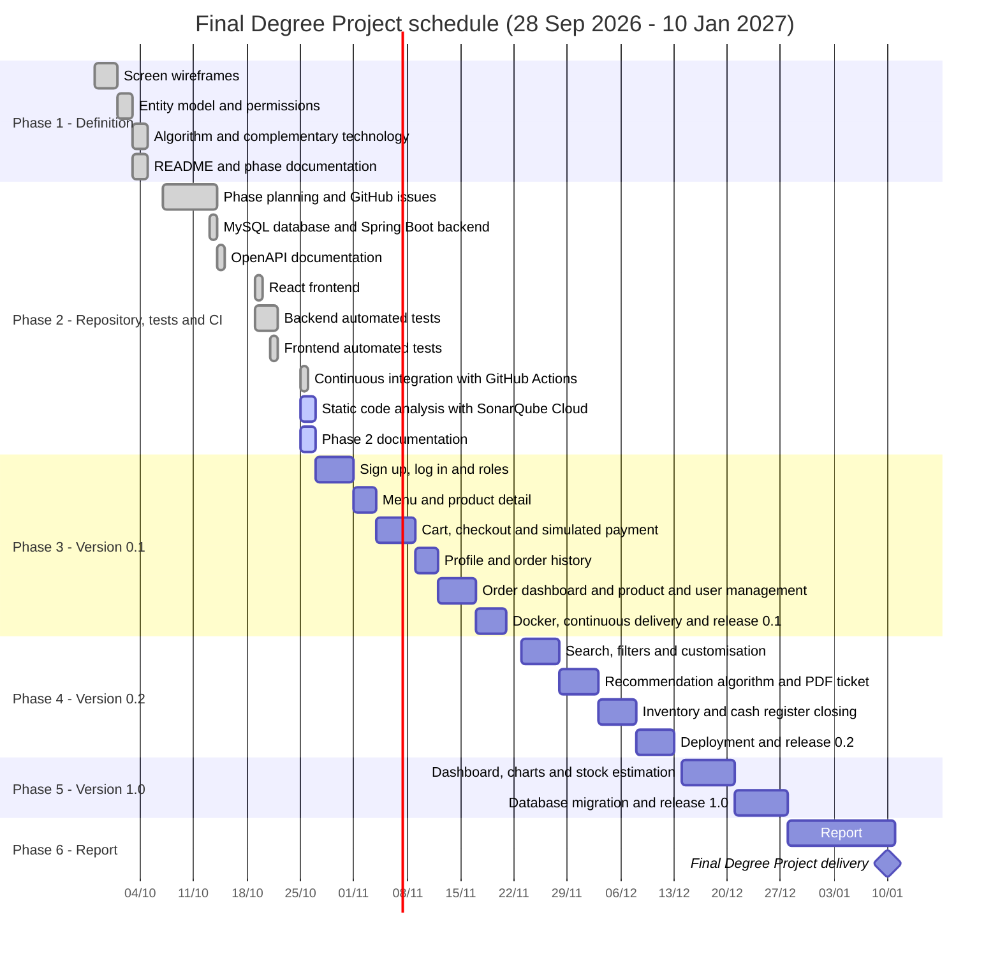

# Methodology

[← Back to README](../README.md)

The development is organised in seven phases with the final delivery around 10 January. The implementation phases follow the order of the features: first the basic ones, then the intermediate ones and finally the advanced ones.

| Phase | Description | Dates |
|:---:|---|---|
| **1** | Definition of features and screens (wireframes, entity model, algorithm, complementary technology, README) | 28 Sep – 4 Oct 2026 |
| **2** | Repository, tests and CI (backend and frontend projects, minimal feature, automated tests, continuous integration and static code analysis) | 5 Oct – 26 Oct 2026 |
| **3** | Version 0.1 - Basic features (MVP) and Docker | 27 Oct – 22 Nov 2026 |
| **4** | Version 0.2 - Intermediate features (search, customisation, recommendations, PDF ticket, inventory, cash register closing) and deployment | 23 Nov – 13 Dec 2026 |
| **5** | Version 1.0 - Advanced features (charts, stock estimation) | 14 Dec – 27 Dec 2026 |
| **6** | Report | 28 Dec 2026 – 10 Jan 2027 |
| **7** | Defence | To be determined |

